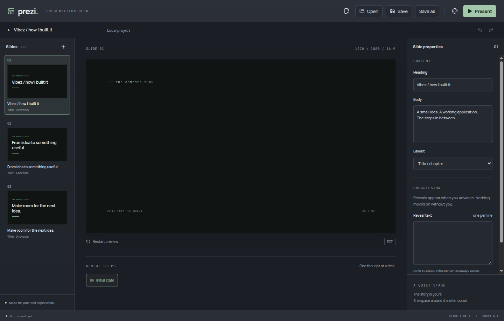

# Prezi

A small local-first Electron presentation desk for narrated explanations. Built with strict TypeScript, React, Vite and Remotion. Recording happens in OBS or ClipForge.

Checkpoint one covers phases 1-5: edit a text deck, save it locally, reopen it and present manually controlled animated reveals. Media, MCP and custom source are the next checkpoints.



## Run

Use Node 22 and Yarn 1.22.22. Dependencies and fonts are installed locally; normal presentation playback does not require a network connection.

```sh
yarn install --frozen-lockfile
yarn dev
```

To run the built app:

```sh
yarn build
yarn start
```

There is no installer yet. Desktop packaging is part of checkpoint three.

## Work on a deck

- **New presentation** creates a blank deck. The first launch includes a small Vibez text example.
- Use the slide rail and inspector to add, duplicate, delete, reorder and edit slides. At least one slide remains in the deck.
- Click a heading or body on the canvas to type directly. Selection follows the same text property in the inspector; Escape or Enter leaves heading editing. Body text supports line breaks.
- Edit the presentation name in the document bar. Text edits reach the backend while the field is still focused.
- Choose **Title / chapter** or **Text / reveals**. Enter one reveal per line, up to 30. Use the reveal buttons to preview any step or **Restart preview** to replay the initial entrance.
- Undo and redo operate on content edits. Each accepted edit batch is one undo action; typing creates successive edits.
- **Code** opens a read-only browser for Remotion components, schemas and presentation styles. **Slide properties** shows live instance values; use the inspector to change them. Custom source editing and compilation follow in phases 9-10.
- **Import media** copies a local image or video into the open deck. Image slides use a text-and-media composition. Remove the asset from the inspector or undo its import. Video playback settings follow in the next slice.
- Default saves create a single `.prezi` file containing deck content, scene source, local media, built-in fonts and their licences. Move that file on its own. Legacy JSON projects still use an adjacent `<project path>.assets` directory.
- **Save**, **Save as** and **Open** use native file dialogs. Projects use versioned `.prezi` archives and are saved with a temporary file, sync and atomic rename. Existing `.prezi.json` files remain readable; use Save as to create a portable archive.
- The app asks whether to save, discard or cancel before replacing or closing a changed deck. Failed saves and invalid imports leave the current deck open.
- Appearance has Studio, Aluminium and Paper materials, light/dark modes and five accents. These preferences persist locally and do not change the deck's near-black/green visual theme.

## Present

**Present** starts at the first slide and its initial reveal state every time. The same Remotion scene component drives editor preview and presentation playback at 1920 x 1080, scaled to fit without reflow.

| Input               | Action                                                |
| ------------------- | ----------------------------------------------------- |
| Space / Right Arrow | Next reveal, then next slide                          |
| Left Arrow          | Previous reveal, or the previous slide's final reveal |
| Escape              | Return to the editor and leave fullscreen             |
| Full screen         | Hide the presenter toolbar and fill the display       |

The final slide stays visible. There is no automatic progression. Repeated keydown events and navigation during the brief 400 ms animation lock are ignored. Space cannot scroll the stage, and typing in the editor does not trigger presentation navigation.

Fullscreen contains only the stage and any letterboxing. In windowed presentation mode, recording tools should capture the stage region rather than its separate presenter toolbar. Recording integration is outside this checkpoint.

## Checks

```sh
yarn verify
yarn test:electron
```

`verify` runs formatting, linting, strict type checks, domain tests and a production build. Electron checks require a display. In headless Linux:

```sh
xvfb-run --auto-servernum yarn test:electron
```

CI runs the same checks. `yarn format` formats code; `yarn test:watch` runs domain tests during development.

See [verification evidence](docs/verification/checkpoint-1.md), the [checkpoint plan](docs/checkpoints.md), [architecture decisions](docs/adr/0001-local-desktop.md), the [product brief](docs/product-brief.md) and [third-party notices](THIRD_PARTY_NOTICES.md).
