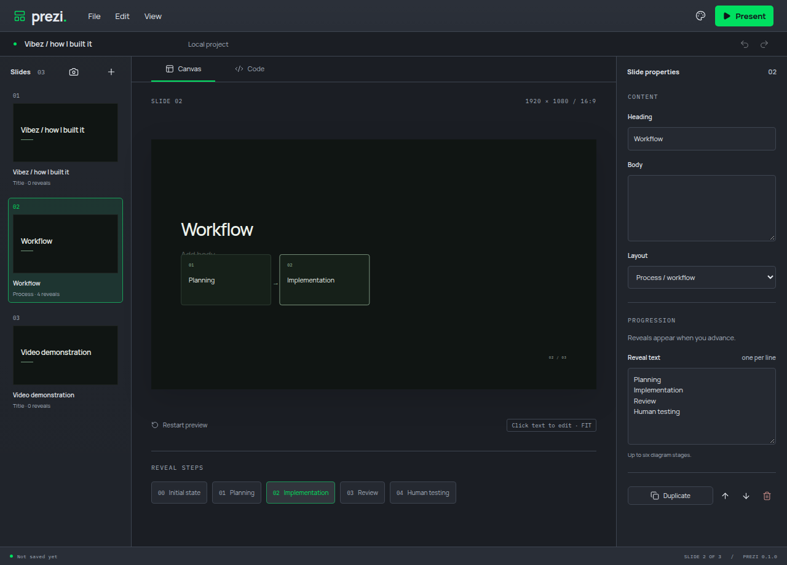

# Prezi

Local Electron presentation editor built with TypeScript, React and Remotion. Present with manual reveals; record using OBS or ClipForge.

Human and MCP clients edit the same project, including custom Remotion scenes, media, fonts and programmable transitions. Code drafts save with portable projects and use explicit Apply validation.

[Website and downloads](https://alexanderwanyoike.github.io/prezi/) · [v0.1.0 release notes](docs/releases/v0.1.0.md)



## Run

Use Node 22 and Yarn 1.22.22. Dependencies and fonts are installed locally; normal presentation playback does not require a network connection.

```sh
yarn install --frozen-lockfile
yarn dev
```

To run the built app:

```sh
yarn build
yarn start
```

Build native installers with `yarn package:make --linux --x64`, `--win --x64` or `--mac --arm64` / `--mac --x64` on the matching platform. Output is written to `release/`. Linux uses AppImage, Windows uses a per-user NSIS installer and macOS uses a DMG. Preview Windows installers are unsigned; Mac bundles are ad-hoc signed and not notarized. See [installer verification and release workflow](docs/verification/desktop-installers.md).

## Work on a deck

- Use the styled **File / Edit / View** application menu for document commands, editing and workspace views. The menus follow the selected theme; file pickers and save prompts use desktop dialogs.
- Startup and **File > New presentation** create an untitled deck with one empty slide and a neutral white-and-grey theme.
- Use the slide rail and inspector to add, duplicate, delete, reorder and edit slides. At least one slide remains in the deck.
- Click a heading or body on the canvas to type directly. Selection follows the same text property in the inspector; Escape or Enter leaves heading editing. Body text supports line breaks.
- Select attached media or a custom layer with mapped frame properties to reveal move/resize handles. Each completed gesture creates one shared Undo action; Escape cancels. The inspector retains exact numeric controls.
- Edit the presentation name in the document bar. Text edits reach the backend while the field is still focused.
- Missing media can be repaired with **Locate replacement…** in Media properties. **Locate font…** in Presentation theme repairs a font registration and its theme references. Replacements retain placement/playback and supplied credits, with shared Undo.
- **File > Import font** adds TTF/OTF/WOFF/WOFF2 to the project. Choose it in Presentation theme and retain supplied source/attribution and licence text there. Fonts travel inside portable saves.
- **View > Presentation theme** controls saved deck colours, fonts, canvas padding, entrance motion and crossfade timing. Reusable layouts use it directly; custom code receives `SceneProps.theme`. Application Appearance remains a local preference.
- Undo and redo operate on content edits. Each accepted agent batch is one undo action. Continuous editor typing, source edits and colour changes share an Undo group; a pause, focus change, document action or intervening agent edit starts a fresh boundary. Content updates still reach the shared owner while editing. The Edit menu and button tooltips show the next action label, including agent batches. History holds up to 50 batches for the open deck and resets when opening or creating a project.
- Choose **Title / chapter**, **Text / reveals**, **Code explanation** or **Process / workflow** in Layout. Diagram stages and code notes use manual reveal steps.
- The **Canvas / Code** tabs switch the workspace view. **Code** opens Remotion components, schemas and presentation styles. Choose **Create custom scene** or **Edit scene code** to edit TSX/TS/JSON drafts and declared properties. Drafts save with the project; **Apply scene code** validates before replacing the working scene. Invalid source preserves the last working version. Built-in references and **Slide properties** are read-only. See [code authoring](docs/verification/scene-code-editor.md).
- **Code > Transition** edits transition source and staged properties. **Apply transition code** validates numeric motion samples; failed code retains the working transition. Space still controls progression. See [transition authoring](docs/verification/transition-code-editor.md).
- **File > Import media** copies a local image or video into the open deck. Image slides use a text-and-media composition. Remove the asset from the inspector or undo its import. Use Canvas handles or the inspector to position/resize media and choose contain or cover. Video has autoplay, looping, mute and volume settings; hover it for play/pause/restart controls.
- A custom scene that does not become ready within ten visible seconds detaches with an error. After startup, a stalled scene detaches after six seconds without a heartbeat while visible. Undo, correct its properties/source or choose Restart scene. Other slides and the editor remain usable.
- Default saves create a single `.prezi` file containing deck content, scene source, local media, built-in fonts and their licences. Move that file on its own. Legacy JSON projects still use an adjacent `<project path>.assets` directory.
- **File > Save**, **Save as** and **Open** use native file dialogs. Projects use versioned `.prezi` archives and are saved with a temporary file, sync and atomic rename. Existing `.prezi.json` files remain readable; use Save as to create a portable archive.
- The app asks whether to save, discard or cancel before replacing or closing a changed deck. Failed saves and invalid imports leave the current deck open.
- Appearance has Studio, Aluminium and Paper materials, light/dark modes and five accents. These preferences persist locally and are separate from the deck's saved presentation theme.

## Application shortcuts

Use Ctrl on Linux/Windows and Command on macOS. Shortcuts are local to the application window.

| Shortcut              | Action                      |
| --------------------- | --------------------------- |
| Ctrl+N / Ctrl+O       | New / open presentation     |
| Ctrl+S / Ctrl+Shift+S | Save / save as              |
| Ctrl+I / Ctrl+W       | Import media / close window |
| Ctrl+1 / Ctrl+2       | Canvas / Code tab           |
| Ctrl+Z / Ctrl+Shift+Z | Undo / redo                 |
| Ctrl+, / F5           | Appearance / Present        |

Cut, copy, paste and select all use the focused editor. Alt+F, Alt+E and Alt+V open menus; arrow keys navigate, Escape dismisses and Tab returns to the workspace.

## Present

**Present** starts at the first slide and its initial reveal state every time. The same Remotion scene component drives editor preview and presentation playback at 1920 x 1080, scaled to fit without reflow.

| Input               | Action                                                |
| ------------------- | ----------------------------------------------------- |
| Space / Right Arrow | Next reveal, then next slide                          |
| Left Arrow          | Previous reveal, or the previous slide's final reveal |
| Escape              | Return to the editor and leave fullscreen             |
| Full screen         | Hide the presenter toolbar and fill the display       |

Video keeps playing while reveals hold. Reveals retain the current video node; leaving the slide pauses and mutes it, and returning starts it again. Editor preview starts paused. Video completion does not advance.

The final slide stays visible. There is no automatic progression. Repeated keydown events and navigation during the brief 400 ms animation lock are ignored. Space cannot scroll the stage, and typing in the editor does not trigger presentation navigation.

Fullscreen contains only the stage and any letterboxing. In windowed presentation mode, recording tools should capture the stage region rather than its separate presenter toolbar. Recording remains external.

## Agent collaboration

Choose **View > Agent connection** to copy a private Streamable HTTP configuration. The agent and editor share content, revisions and undo history. See [connection instructions and tools](docs/mcp.md).

## Custom scenes

Agents can compile React/Remotion components with declared editable properties and named layers. The human edits their text directly on the stage and adjusts properties in the inspector. Source, properties and Undo/Redo share one project owner. Failed source and render validation preserve the working scene. Code view shows the custom source; see [MCP authoring](docs/mcp.md#custom-remotion-scenes) and [verification and resource boundaries](docs/verification/custom-scenes.md).

## Desktop updates

Choose **View > Application updates**. Installed Windows/Linux builds offer explicit download, verification and restart; the app protects unsaved work and reopens the saved deck afterward. Other installed formats use the stable release page. Development builds explain that updates require installation. Releases require promotion to main, an annotated version tag and publication of the verified draft. See [runtime verification](docs/verification/desktop-updates.md) and [installer verification](docs/verification/desktop-installers.md).

## Renderer limits

Linux scene and preview renderers default to 512 MiB, zero swap and one CPU after preparation. Set `PREZI_SCENE_MEMORY_MB` to an integer from 256 to 1024 before starting the app to adjust memory. Runtime warmup precedes scope attachment. Other platforms retain process isolation and deadlines.

## Checks

```sh
yarn verify
yarn test:electron
```

`verify` runs formatting, linting, strict type checks, domain tests and a production build. Electron checks require a display. In headless Linux:

```sh
xvfb-run --auto-servernum yarn test:electron
```

CI runs the same checks. `yarn format` formats code; `yarn test:watch` runs domain tests during development.

See [verification evidence](docs/verification/checkpoint-1.md), the [checkpoint plan](docs/checkpoints.md), [architecture decisions](docs/adr/0001-local-desktop.md), the [product brief](docs/product-brief.md) and [third-party notices](THIRD_PARTY_NOTICES.md).

See [delivery and verification](docs/delivery.md) for the PR order, installed checks and recording evidence.
