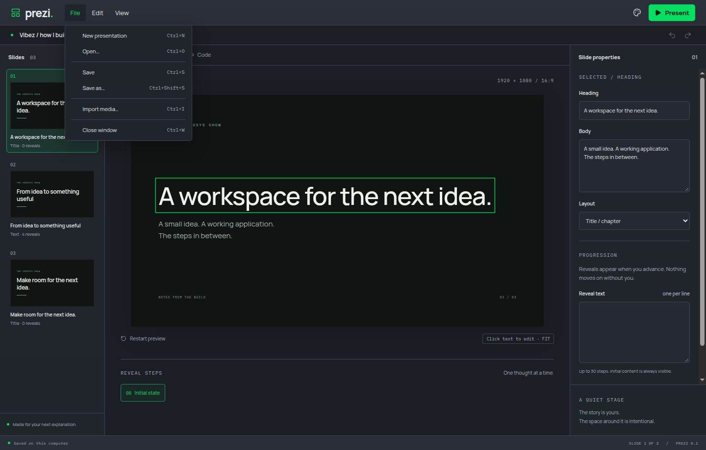
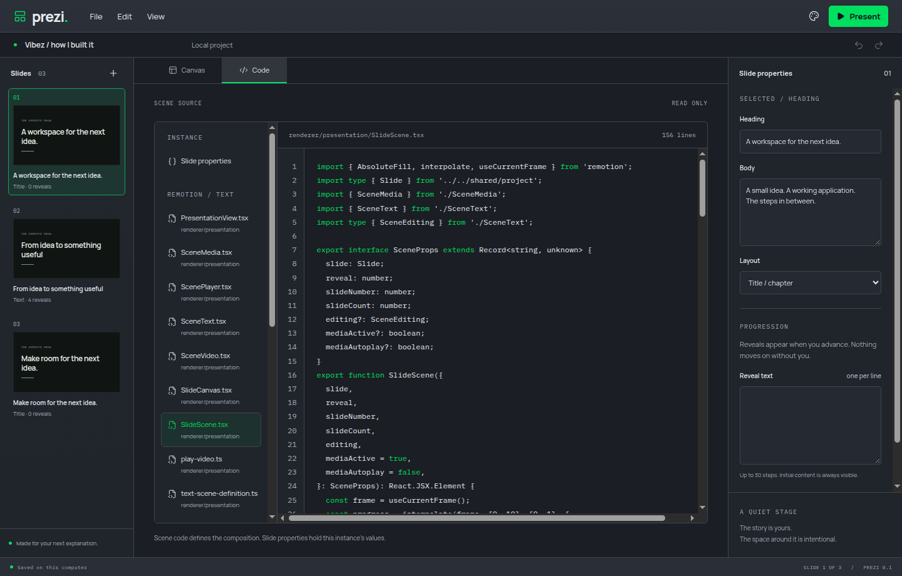
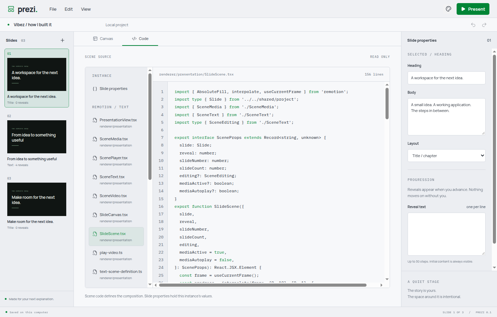

# Application menus and workspace tabs

File, Edit and View are styled application menus inside the Electron window. They replace the header's individual file buttons. Canvas and Code are workspace tabs, also available through View and Ctrl/Command+1/2. The remaining header actions are Appearance and Present. The title bar shows the document name and unsaved marker.

Menu commands share one action map with Electron window-local shortcuts. File pickers, editing operations and unsaved-change prompts still use Electron. Focus and text selection return to the editor before cut/copy/paste/select-all. Read-only source selection uses CodeMirror's public selection command, so copying selects the entire document, including offscreen content. Closing from the menu or shortcut waits for queued local edits before invoking the existing unsaved-change flow.

## Established patterns

- Electron's [before-input-event](https://www.electronjs.org/docs/latest/api/web-contents#event-before-input-event) supplies window-local shortcut interception. No global shortcuts are installed. `webContents` supplies native editing operations.
- The [WAI-ARIA APG menubar pattern](https://www.w3.org/WAI/ARIA/apg/patterns/menubar/) informs menu roles, arrow-key movement, focus and dismissal. The implementation supports left/right between open menus, up/down within menus, Home/End, Escape and Tab dismissal.
- CodeMirror's public [commands](https://github.com/codemirror/commands) provide document selection and its standard keymap. No dependency source was copied; CodeMirror is MIT licensed.

## Verified

- Meaningful Electron tests failed before implementation because header file buttons remained and the workspace tabs were absent. Those tests were committed separately from implementation.
- Separate regressions reproduced partial source copying, non-wrapping tab keys, missing menu-to-menu keyboard navigation and a close race that saved only `Clos` from a queued sentence. Each failed before its respective implementation commit.
- `yarn verify` passed formatting, lint, strict TypeScript, 14 domain tests and the production build. All 14 Electron journeys passed on a private virtual display.
- Exercised File new/open/save/import, Canvas/Code switching, menu dismissal, tab wrapping and focused source select-all/copy. Existing portable-project, image/video, direct text editing, undo and fullscreen journeys remain covered.
- Manually exercised actual Electron `before-input-event` using xdotool Ctrl+S/N/O inside Xvfb. New was received once and advanced the revision exactly once, then Open restored the saved text. The clipboard checks used the private display's clipboard.
- Inspected the File menu and Code workspace in dark and light themes. At the 1000x680 minimum window, document width remained 1000 px with no outer horizontal overflow.
- Verification used private profiles and virtual displays, with audio muted. Test instances were closed afterward. No user desktop window was operated.
- Native keyboard input was manually verified on Linux only. macOS modifier labels and native document flags are implemented but have not been exercised on macOS.

