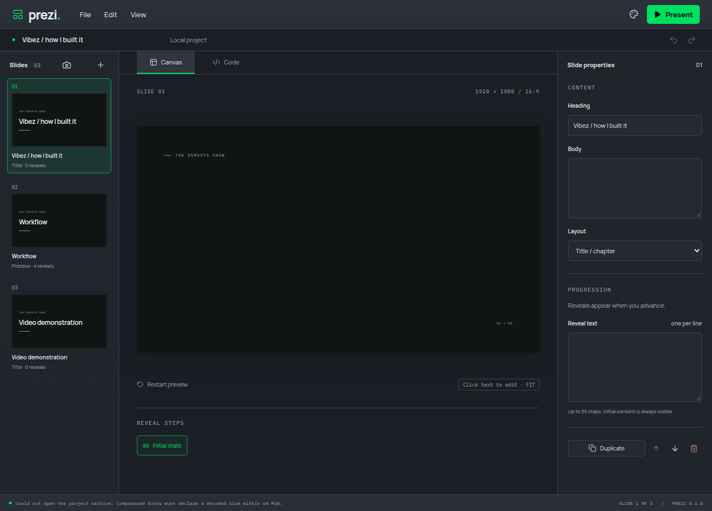

# Archived font validation

Review finding: #21. Archived WOFF and WOFF2 resources previously bypassed the 64 MiB declared decoded-size guard used during font import.

Import and archive adoption now use the same bounded header validator. Archive extraction checks the actual format against its registration and rejects invalid or oversized expansion before replacing the current project. Failed opening removes its extraction directory. The existing header-only font policy is reused; no new decoder or dependency is introduced.

Both WOFF and WOFF2 archive regressions failed before implementation. Ten font/archive/recovery tests pass, including real font bytes surviving save and reopen. Strict TypeScript, targeted lint, the production build and the real Electron font/credits/portable journey pass.

A separate manual Electron run opened a crafted WOFF2 archive through File > Open. It displayed the decoded-size error and retained the original project identity. Verification used a private display/profile, muted audio and a 2 GiB/zero-swap scope.

