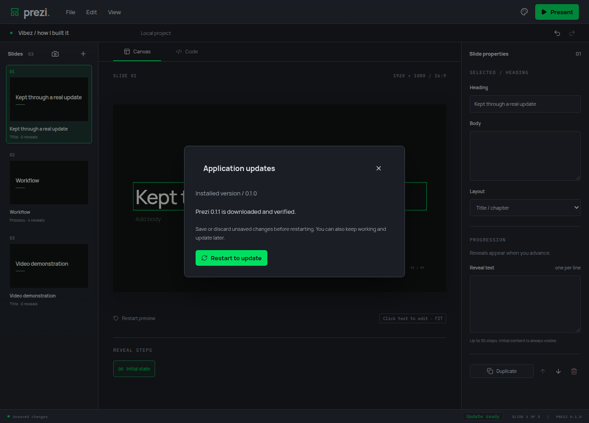
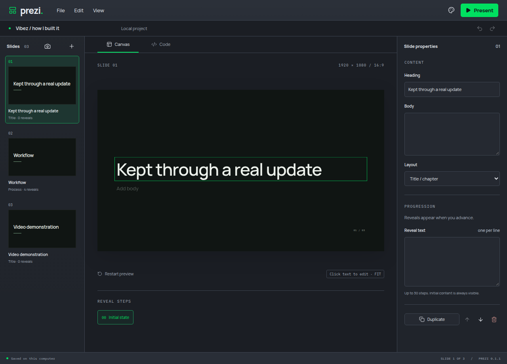

# Await shutdown cleanup

Review finding: #5. Electron did not await the asynchronous disposal launched by will-quit, leaving both imported files and extracted project resources behind.

The quit handler now prevents default termination once, stops application jobs, waits for MCP closure and typed resource disposal, then exits. Each resource deletion is awaited even if another deletion fails; expected filesystem failures return IO_ERROR and are reported at shutdown. The AppImage handoff runs at quit, after cleanup, so the replacement does not start while the old process is still waiting for disposal. This follows Electron's documented preventDefault lifecycle pattern: https://www.electronjs.org/docs/latest/api/app#event-will-quit .

Three regressions were confirmed before their implementation commits: both resource directories remained after actual Electron quit, one failed deletion returned before healthy deletions completed, and the update handoff started before quit. Fourteen related media/archive/persistence/update tests pass, along with targeted lint and strict types. The real Electron normal-quit regression passes.

A separate manual Electron run imported media, saved and reopened a portable project, then quit. It reported one imported directory and one extracted directory before quit, with zero remaining afterward. Fresh 0.1.0 and private 0.1.1 AppImages also passed the actual download/checksum/replacement/restart/reopen journey. Screenshots show the verified update and reopened edit.

All app verification used private displays/profiles and muted audio. Packaging and update scopes were limited to 2 GiB with zero swap. Observed charged peaks were 1640.1 MiB for the baseline build, 1455.9 MiB for the candidate and 1044.0 MiB for the installed update; all scopes reported zero OOM events. Raw readings are retained in [shutdown-metrics.json](shutdown-metrics.json). These are warmed-cache cgroup observations, not universal memory guarantees.

