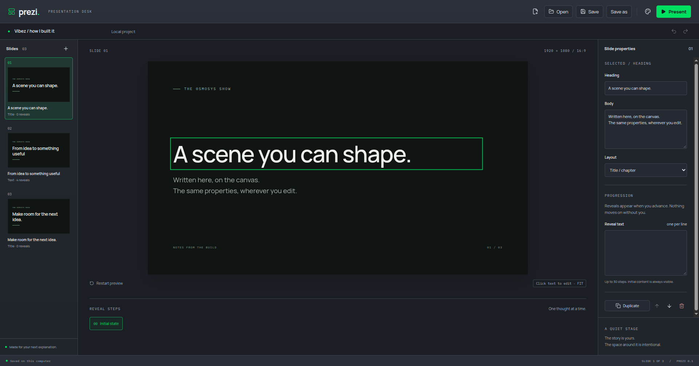
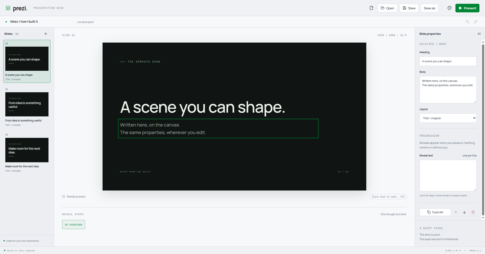
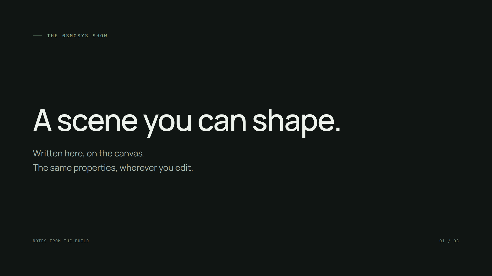

# Canvas text editing

Click the rendered heading or body and type directly. Selection is reflected in the inspector, and focusing either inspector field selects the corresponding canvas layer. Both surfaces submit the same revision-guarded updateSlide operation to the project owner. Presentation uses the same component without editor bindings.

The text scene definition binds its component, property schema and named editable layers. Schema limits are shared by the owner, inspector and canvas. This is the first code-defined scene; custom-source compilation and custom property registration remain later checkpoint work. Dragging, resizing and typography controls are not included in this text-editing slice.

## Established patterns

- [Remotion Player interactions](https://www.remotion.dev/docs/player/drag-and-drop) describes passing update callbacks through inputProps with controls disabled. This implementation follows that pattern without copying source.
- [Remotion prop schemas](https://www.remotion.dev/docs/schemas) informs the Zod property definition shared with the project boundary. No dependency implementation was copied.
- [Native plaintext editing](https://developer.mozilla.org/en-US/docs/Web/HTML/Reference/Global_attributes/contenteditable) supplies caret, selection and plain-text paste. React leaves focused text DOM under native ownership, avoiding caret resets after accepted project snapshots. Empty native line-break placeholders are normalised to empty content.

## Verified

- `yarn verify` passed formatting, lint, strict TypeScript, 8 domain tests and a production build. All 7 Electron journeys passed.

- The Electron test failed first because the canvas had no editable textbox. The test was committed separately before implementation.
- Further regression tests failed for a native empty-line placeholder and the empty heading's different editor/presentation height. Each failing test was committed separately before its fix.
- Typed into the canvas heading and multiline body, checked inspector updates, edited through the inspector, used undo, and added text to an empty body.
- Compared normalised text positions between preview and presentation with an empty body and with an empty heading.
- Manually saved the canvas-edited sample deck, created a blank deck, reopened the saved file and confirmed the heading and multiline body survived.
- Manually inspected selected heading/body in dark and light modes and a clean fullscreen presentation. No contenteditable elements remain in presentation.
- Electron app metrics for one isolated sample instance reported working sets of 165 MiB main, 153 MiB GPU, 136 MiB renderer and 151 MiB across two utility processes, approximately 605 MiB summed. These process values can count shared pages more than once; this is a sample, not a system memory-pressure diagnosis. Test instances are closed after verification and desktop tests use one worker. The visible checks interrupted the user's desktop; subsequent UI verification must run on an isolated virtual display, using `xvfb-run --auto-servernum yarn test:electron`, rather than DISPLAY=:0.

