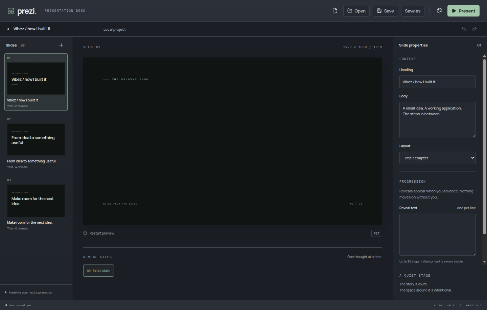
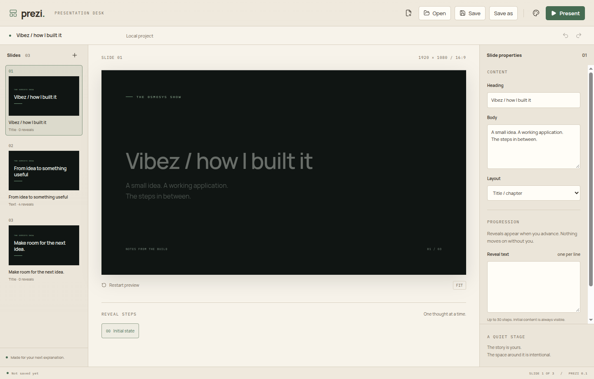
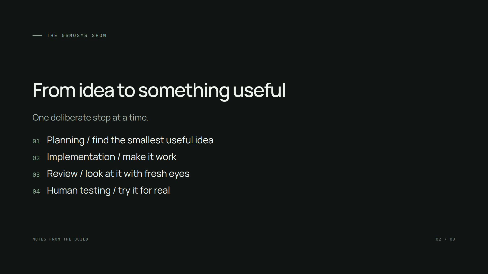

# Checkpoint 1 verification

Verified on Linux on 31 October 2026 using Electron 45, Node 22 and Yarn 1.22.22. This covers phases 1-5.

## Automated checks

- `yarn verify`: formatting, Airbnb-based type-aware linting, strict TypeScript, 8 domain tests and a production build.
- `yarn test:electron`: 4 Electron journeys, including both built-file loading and the Vite development server.
- Domain coverage: shared text edits, revision conflicts, atomic failure, safe retries, stable slide arrangement, one-batch undo/redo, fresh-project identity, exact save/reopen, reveal navigation and keyboard guards.
- Desktop coverage: persistent appearance, editing while focused, slide arrangement, file commands, malformed-file recovery, manual reveal holds, repeated keys, transitions, fullscreen and return to the editor.
- Native chooser responses are controlled in automated tests; project files are written and read from real temporary directories.

Tests were introduced in separate failing-test commits before their implementations. Refactoring commits remain separate.

## Hands-on Electron pass

Created a three-slide deck through the interface with four reveal lines, saved it, closed the entire Electron process, relaunched and reopened the saved file. Confirmed matching content, stable IDs and a clean saved state.

Exercised reveal preview, forward and backward presentation, a held reveal between interactions, all four reveal steps, final-slide hold, fullscreen and Escape. Inspected the actual rendered dark editor, light Paper editor and fullscreen presentation. Confirmed two mounted scenes during a crossfade and one after it completes.

Changed a heading while it remained focused, requested window close with a controlled Cancel response, and confirmed the same window and unsaved text remained. Manual file-command checks used real disk I/O with controlled chooser responses. The native save chooser was opened and visually inspected, but completing native chooser interaction through desktop automation was not verified.

## Resource observations

On the final build, Electron `app.getAppMetrics()` reported an aggregate process working-set baseline of 621.13 MiB for the three-slide text deck. A 12-sample, 100 ms interval transition check peaked at 623.34 MiB and a sum of reported process CPU percentages of 12.77%; the settled last sample reported 0% CPU. The observed processes were Browser, GPU, Tab and two Utility processes.

Working sets include shared pages, so their sum is a conservative process total rather than a unique-memory measurement. These short samples are observations for a text-only deck, not a guarantee or a media workload benchmark. The final text-only Player configuration disables its unused shared audio pool. No compilation or rendering workers run in this checkpoint.

## Screenshots

Actual Electron renderer captures, not mockups:

## Limits

Video/audio, MCP, custom source, imported fonts, animated diagrams, installer packaging and the external recording rehearsal remain at later checkpoints. The Vibez example currently uses animated text reveals. Long bodies and many reveal lines require author judgement to fit a readable slide. Undo history is bounded to 50 project states; edit retries cache the latest 128 accepted requests. Resource budgets for expensive jobs will be added with those jobs.
