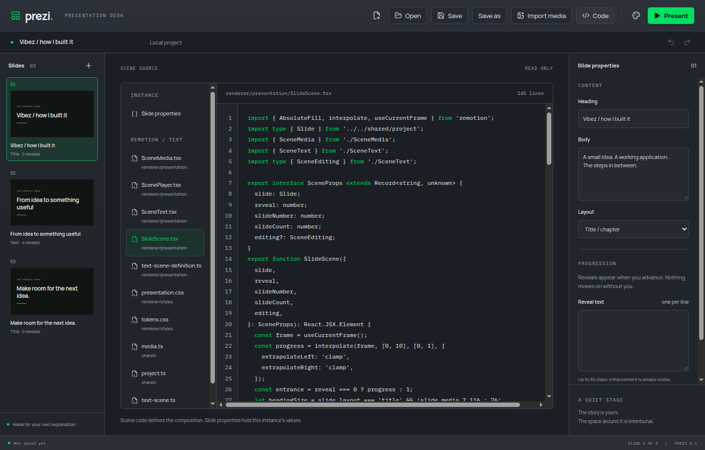
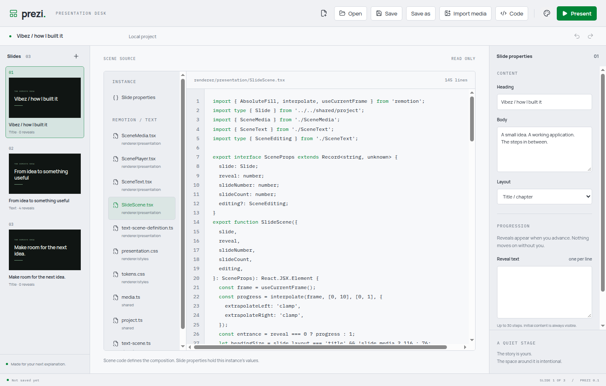

# Scene Code view

Use Code in the header to inspect the scene's TS/TSX, property schemas and presentation styles. A new deck shows bundled application source. Reopened `.prezi` projects show their stored source files. Slide properties shows the selected instance's live JSON values while the inspector stays usable. Source inspection does not create content revisions; Undo still applies only to actual deck edits.

The viewer is read-only in this slice. Editing/compiling custom source is planned for phases 9-10. CodeMirror is loaded only when opened; it replaces the preview and mounts one view at a time, destroying that view on file replacement or exit. No background Player is mounted behind the code browser.

## Established pattern

The [official focusable read-only CodeMirror example](https://github.com/codemirror/website/blob/main/site/examples/readonly/readonly.ts) informs the readOnly/editable settings and keyboard focus. Language packages supply TypeScript/JSX, JSON and CSS parsing. The MIT licences are preserved in the repository. No custom parser or dependency source was copied.

## Verified

- `yarn verify` passed formatting, lint, strict TypeScript, 13 domain tests and build. All 10 Electron journeys passed on a virtual display.

- The desktop test failed before implementation because Code view did not exist, and its failing test was committed separately.
- Exercised source file selection, live properties during inspector typing, returning to canvas and Undo, plus portable save/reopen followed by source inspection.
- Manual inspection found an 18 px gutter offset. A regression test failed for line-number alignment before a separate CSS fix; it now passes.
- Inspected highlighted source in dark/light modes and live properties at the 1000x680 minimum window. The document width remained 1000 px with no outer horizontal overflow. All work used private virtual displays.
- The code browser is emitted as a separate approximately 763 kB uncompressed chunk. The initial renderer bundle remains approximately 1.49 MB uncompressed.
- One sample Code view reported approximately 647 MiB summed process working sets: main 180, GPU 156, renderer 160, utility processes 151. Shared pages may be counted more than once; this is a sample rather than a memory-pressure diagnosis. Test apps were closed afterward.

