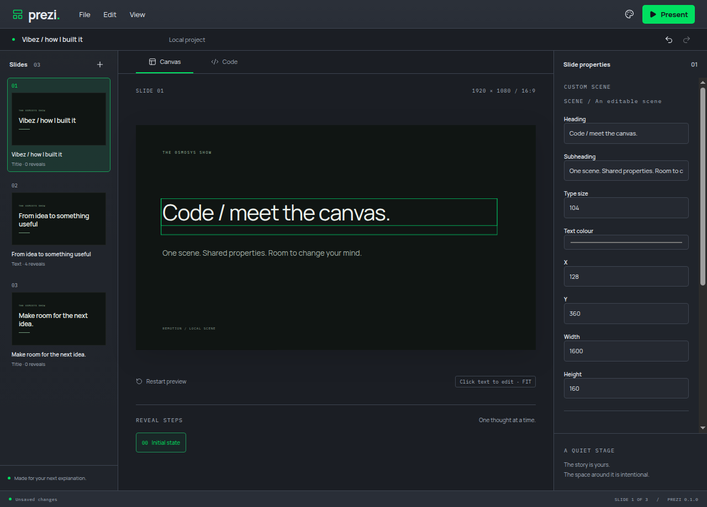
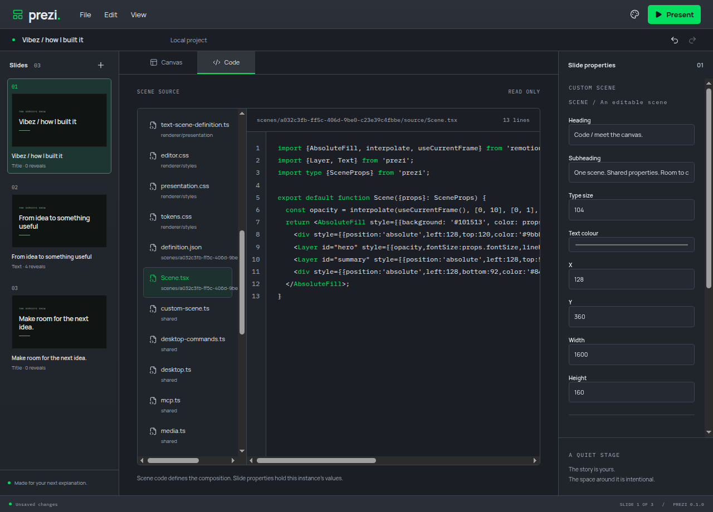
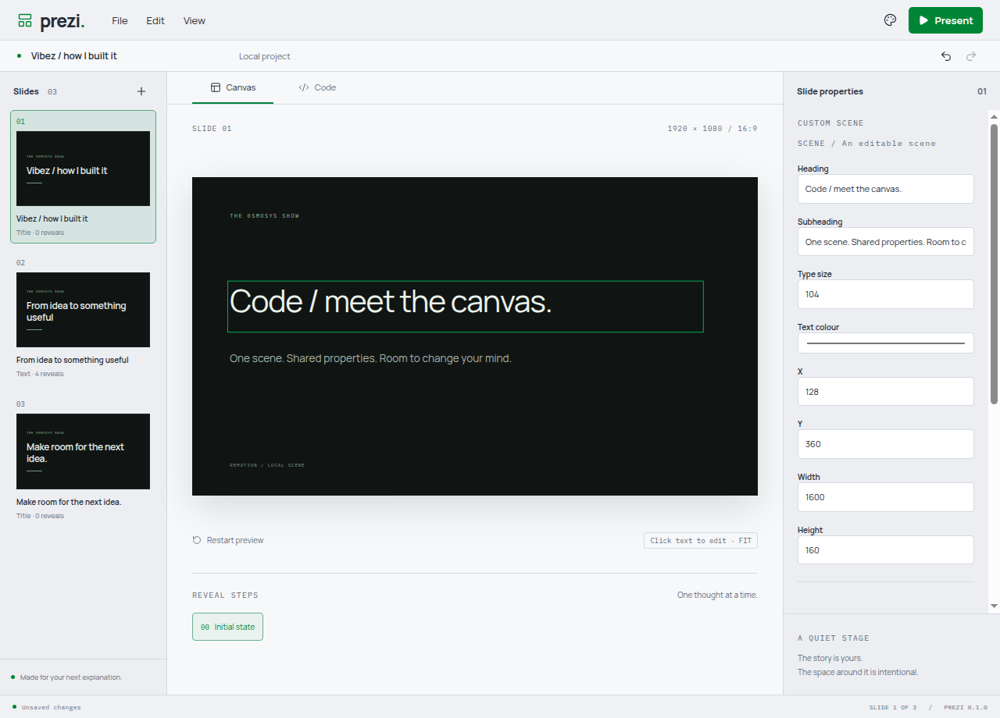
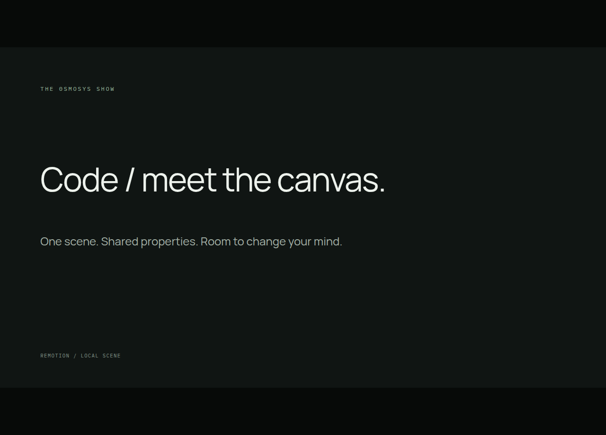

# Custom scenes and editable instances

A project stores reusable scene definitions separately from slide instances. A definition contains TSX/local source, compiled browser code, typed editable fields and named layers. An instance holds a definition ID and its property overrides. Defaults come from the definition. The owner validates both together and installs successful source as one labelled Undo action.

The official MCP adapter provides compile_scene, read_job and cancel_job. Compilation and render validation share a bounded serial queue. A stale revision, invalid source, invalid metadata or render failure preserves the working project. Successful code and properties are shared by the editor, presenter, portable file and MCP. Code view exposes custom source and definition JSON alongside built-in references; it remains read-only in this slice. Human source authoring follows separately.

Named Text and Layer helpers provide canvas text editing and stable selection. The inspector generates text, numeric, colour and boolean controls. Property edits merge through the same revisioned owner and shared history. An agent update reaches a focused canvas field without restarting the held animation. Undo also recovers from a property value that causes a runtime exception.

## Execution boundary

Scenes are native browser modules loaded through an import map inside a separate Chromium renderer and origin. They receive no desktop bridge or Node integration. CSP blocks network connections and restricts code/assets to the local scene runtime. Navigation, new windows and permission requests are restricted. The editor verifies process separation before sending source.

Linux applies a 512 MiB cgroup memory limit, zero swap and one CPU to each scene renderer, retaining the same boundary if Chromium reuses that process. Its warm-up allocations precede attachment, so cgroup charge is not the complete renderer footprint. Compilation has the separate 1 GiB process-tree limit documented in scene-compiler.md. Other platforms do not have Linux's hard cgroup limits.

A hidden offscreen renderer checks every frame 0-11 at every declared reveal before source is accepted, with a validation deadline of 20 seconds plus 100 ms per probe (at most 57.2 seconds for 30 reveals). Validation runs at 960 x 540 without opening a visible window. Frame checks do not prove arbitrary future property combinations safe; runtime errors remain isolated and recover through Undo. Live-stall monitoring and bounded image previews follow in the performance/preview slice. Restart preview currently recreates a stalled live scene.

## Verification

- `yarn verify`: formatting, lint, strict types, 38 domain tests and production builds passed.
- All 19 actual Electron journeys passed on isolated Xvfb displays, including shared source installation, late-reveal errors, frame isolation, focused agent edits, named-layer selection, Undo/Redo, runtime-error recovery and presentation keys with the frame focused.
- Manually created a custom chapter through the official SDK, edited its heading in the viewer, inspected the source and live properties, switched dark/light modes, saved a portable .prezi, created a new deck and reopened the saved custom scene. Fullscreen presentation retained the edited content and excluded editor chrome. Screenshots were taken after the entrance reached its held state and visually inspected.
- The demonstrated compilation reported peak memory 175,992,832 bytes and CPU 1,616,305 microseconds, under a 1,073,741,824-byte RAM limit and zero swap. The held custom renderer reported 128,440 KiB working set. The application's six reported process working sets summed to 838,688 KiB (about 819 MiB); this sum counts shared pages more than once. Renderer cgroup peak charge was 10,653,696 bytes after attachment, which excludes warm-up allocations and must not be described as total renderer memory.
- Only private test profiles and displays were used, audio was muted, and all own instances were closed. No user desktop or reference application was operated.

Design references: Electron's isolated-content guidance and site isolation, native browser import maps documented by MDN, the official Remotion Player errorFallback API, and the compiler patterns recorded in scene-compiler.md. No reference source was copied.

