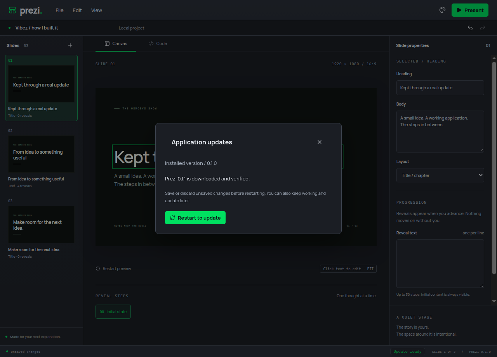
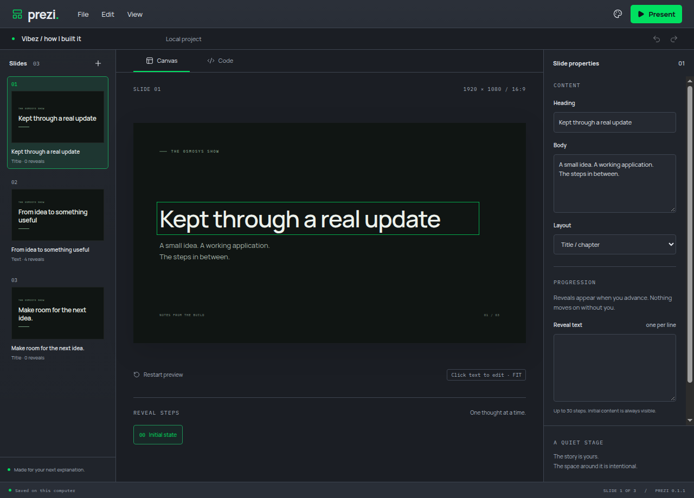

# Native installers and update rehearsal

Electron-builder creates Linux x64 AppImages, Windows x64 NSIS installers and separate macOS arm64/x64 DMGs. Bundles retain local fonts, scene source, licences and updater metadata. The unpacked resource layout intentionally keeps streamed resources accessible as ordinary files, following Auto Digger's packaging approach. Installer icons are original SVG artwork rendered to PNG with FFmpeg's SVG decoder.

## Verification

- `yarn verify` passed formatting, linting, strict TypeScript, 26 domain tests and the production build. All 16 Electron journeys passed on isolated Xvfb displays.
- `xvfb-run --auto-servernum yarn package:test` exercised the actual packaged Linux editor: canvas editing, portable save, archived fonts/source/licences, Code view and shared MCP content.
- `xvfb-run --auto-servernum yarn package:update:test` downloaded a real 0.1.1 AppImage from a loopback fixture, verified it using electron-updater, saved an edited deck, atomically replaced the 0.1.0 AppImage, relaunched 0.1.1 and reopened the saved deck. The installed bytes matched the candidate's SHA-512. Only release discovery and native dialog answers were fixtures; download, metadata validation, replacement, restart and project recovery were real.
- The release verifier checks the complete seven-file platform set, validates installer size and SHA-512 against both update manifests and writes SHA256SUMS only after every check succeeds. A test corrupts installer bytes and verifies that previous checksums remain untouched. The CLI was exercised through Node 22's native TypeScript stripping.
- Packaging ran serially in private systemd units limited to 2 GiB RAM, zero swap and one CPU. Kernel cgroup files confirmed enforcement; this is a ceiling, not a measured peak. App tests used private profiles, muted audio and isolated displays. All test instances were closed.

Windows installation and both Mac DMGs are exercised by the native CI matrix, including running each installed editor. Those platforms were not tested on this Linux host. CI results must be checked before treating them as verified. Automatic Mac updates remain disabled for these ad-hoc signed previews.





## Release procedure

The installer workflow runs on feature PRs and uploads temporary build artifacts. It also assembles and verifies the full release set. This does not publish an update.

After an explicitly approved dev-to-main release PR is merged, create an annotated `v<package version>` tag on main. The workflow rejects tags whose version differs from package.json or whose commit is outside main. A valid tag creates a draft release without replacing an existing release. Publishing that reviewed draft makes its installer and feed files visible to stable update checks. No merge, tag or release publication is performed by this feature PR.

Local commands:

```sh
yarn package:make --linux --x64
xvfb-run --auto-servernum yarn package:test
yarn release:verify release-set 0.1.0
```

The update rehearsal additionally requires a baseline AppImage under `.scratch/update-fixtures/` and a patch-version candidate built into `.scratch/update-fixtures/next`; the workflow shows the exact commands. Generated installers and temporary update fixtures are ignored by Git.

## Yarn bootstrap registry

The Intel macOS installer runner failed twice before dependency installation while Corepack fetched Yarn from registry.yarnpkg.com. The installer workflow now uses Corepack's documented COREPACK_NPM_REGISTRY override to retrieve the same pinned Yarn 1.22.22 from registry.npmjs.org. Integrity checks stay enabled. A fresh private Corepack cache successfully downloaded and ran the pinned Yarn locally; native CI confirms the runner path. See [Corepack environment variables](https://github.com/nodejs/corepack#environment-variables).
