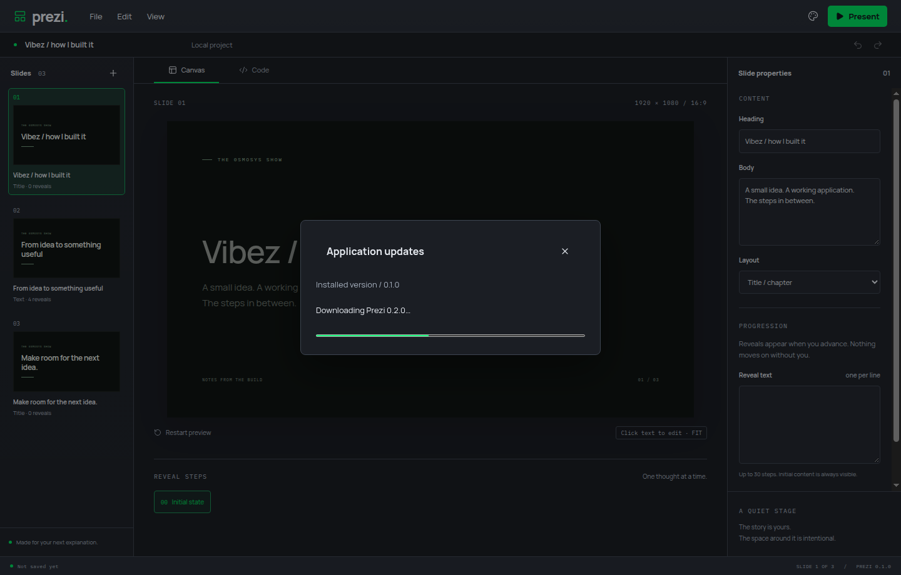
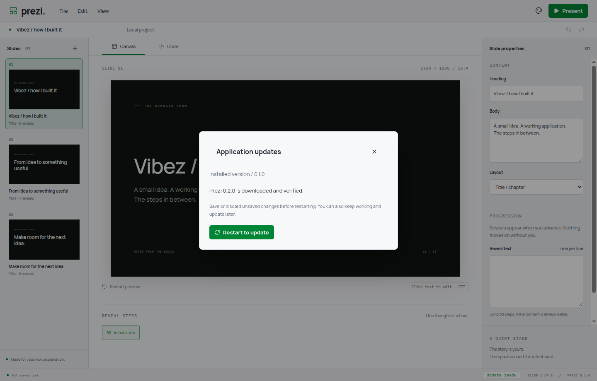

# Desktop updater runtime

View > Application updates shows the installed version, checks stable releases, offers an explicit download and reports progress. A ready update remains optional until Restart to update. Source/development builds display that updates require an installed build. Availability is also shown in the status bar without opening a dialog automatically.

Installed Windows NSIS and Linux AppImage builds use electron-updater for download and checksum verification. The release must contain the exact platform installer and update metadata. A changed candidate is rejected before downloading. Downloads and installation on ordinary quit are disabled by default. Installed builds check quietly after 30 seconds and every six hours. Other installed formats, including the unsigned macOS preview, open the stable release page for a manual installer.

Before installation, local edits flush and the existing save/discard/cancel policy runs. New agent/UI content mutations are then blocked for the handoff; a failed installer unlocks the deck and leaves Retry available. The saved project path is retained privately for one restart. It is consumed before loading the editor again. Linux copies the verified AppImage beside the current file, syncs it and renames it atomically, then launches the same path after quit. The current executable remains intact if staging fails.

## Established patterns

- [electron-builder v26 auto-update](https://www.electron.build/v26/docs/features/auto-update/) informs explicit download/installation and generated platform feed metadata. Runtime electron-updater is pinned to 6.8.11; builder tooling is pinned to 26.18.0.
- Muzo's native-update-backend and same-directory AppImage replacement informed candidate checks, disabled implicit installation and staged replacement. Auto Digger's will-quit AppImage restart informed avoiding the old mounted relaunch helper. These are design references; no dependency or reference application was modified.
- semver validates stable version ordering. The updater's MIT licence is retained in licenses/electron-updater.txt.

## Verified in this slice

- Separate red commits preceded update coordination, AppImage replacement, mutation gating, release validation, native download/verification, Electron controls, resume files, startup reopening and mode-switch dialog dismissal.
- `yarn verify`: formatting, lint, strict TypeScript, 25 domain tests and build passed. All 16 Electron journeys passed in isolated Xvfb sessions.
- Domain tests use actual temporary files for staged replacement and one-use resume data. They verify old executable preservation on failure, permissions, explicit download/progress, refused/failed restart, unlocking, stale release rejection, platform completeness and the unchecked versus current states.
- Electron verification exercises source-build eligibility, native startup recovery of a saved deck, progress, a cancelled restart remaining retryable, Escape and F5 mode switching. Download/restart responses in this UI test are controlled fixtures at the IPC boundary.
- Manually inspected the actual Electron dialog in dark/light modes using an isolated release fixture for available/downloading/ready states. Screenshots show fixture version 0.2.0, not a published release. Audio was muted and all own instances were closed. No host desktop was operated.
- A complete installed AppImage download/restart rehearsal and generated feed/installer validation belong to the following packaging delivery. Windows installation and macOS installer behaviour have not been exercised on this Linux host.

