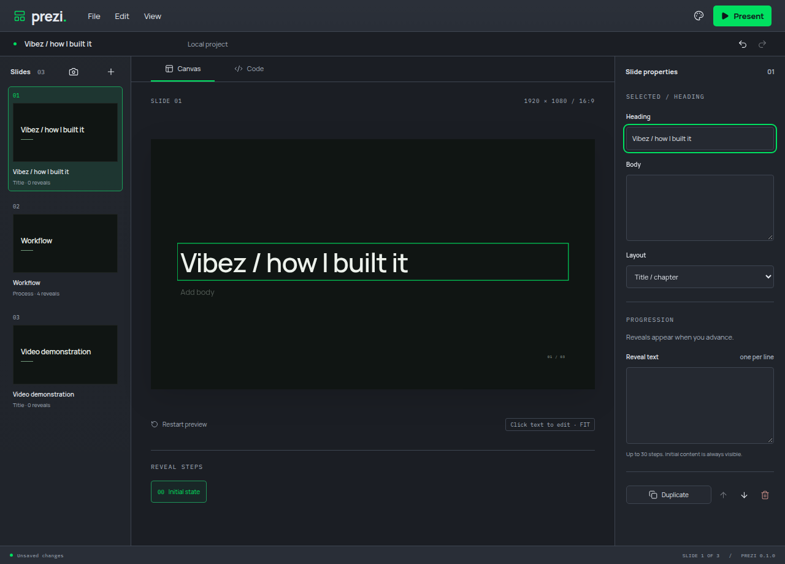

# Rapid input synchronization

The Undo stress test exposed an additional input race: a deferred accepted-value effect could run after a subsequent keystroke and replace its local draft. The dedicated real Electron regression reproduced a missing character before implementation.

Inspector text now synchronizes accepted values in a layout effect, matching the existing Canvas text synchronization pattern. Local input no longer races a deferred draft reset. External accepted edits still update a focused field.

The rapid-input regression passes, including five consecutive runs. Both focused-field component tests and the real Electron MCP-focused inspector/Canvas synchronization journey pass. Targeted lint and the production build pass. A separate manual run rapidly re-entered the supplied Vibez heading and verified that the field and owner retained the exact value. It used a private display/profile, muted audio and a 2 GiB/zero-swap ceiling.

