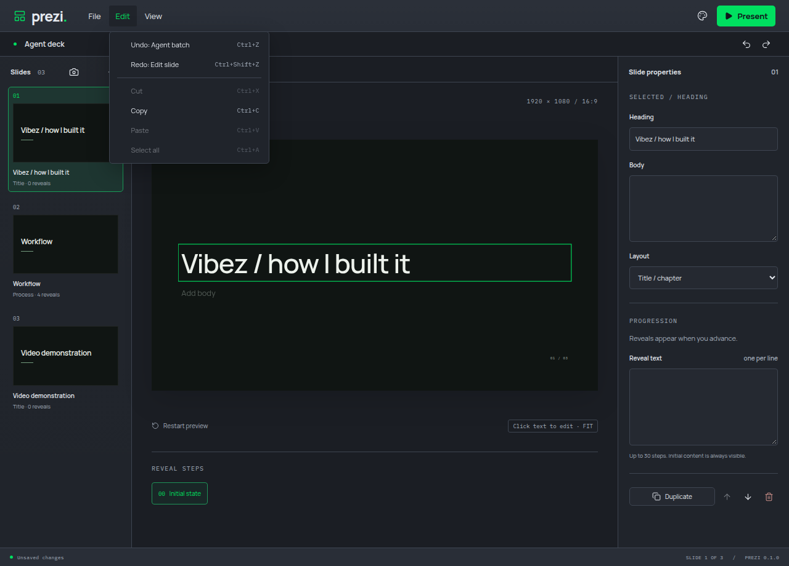
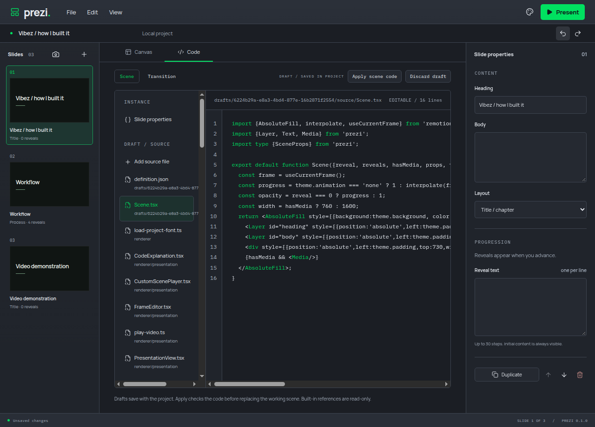

# Continuous editor history

Review findings: #1, #17 and #20. Character-level text/source edits and live colour input could exhaust the 50-entry Undo history and evict earlier agent batches.

The desktop editor now supplies a short-lived group identity for continuous edits to the same target. Groups close after 500 ms idle, focus changes or queued document actions. The owner joins only consecutive revisions with the same identity. An intervening agent batch, source installation, file replacement or Undo/Redo therefore establishes a fresh boundary. MCP edit requests retain their existing independent batch semantics; grouping metadata travels through the trusted desktop envelope instead of the public edit schema. Retry responses retain their original accepted snapshot.

An owner regression and the real desktop typing regression failed before their implementation commits. They now restore a 60-character typing gesture in one Undo while preserving the preceding agent batch. Additional tests cover intervening agent edits, retries and Undo reuse. Thirteen owner/history/draft/theme tests pass.

The code stress journey also exposed a deferred source acknowledgement replacing a subsequent character. The combined workflow reproduced it; an isolated exploration also failed once in ten runs. Code source synchronization now uses the existing layout-effect pattern before subsequent transactions. Both typing/code/colour journeys passed five consecutive runs each. They include 60 source characters and 60 live colour events, each undone to its previous boundary. Five related MCP-focused field, code authoring, transition authoring and desktop-command journeys pass. The full verification passes formatting, lint, strict types, 91 unit tests and the production build.

Separate manual private-display runs exercised both history journeys and inspected the menu's retained agent boundary and restored code/theme state. Verification used muted audio, private profiles and a 2 GiB/zero-swap scope. The ProseMirror transaction-grouping pattern informs the time boundary; no new dependency was added. Draft persistence continues to send each accepted edit through IPC.

