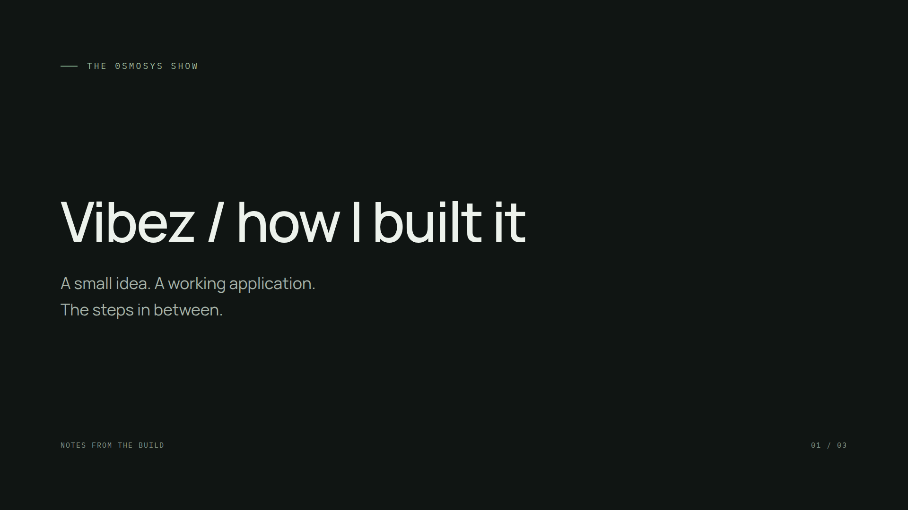
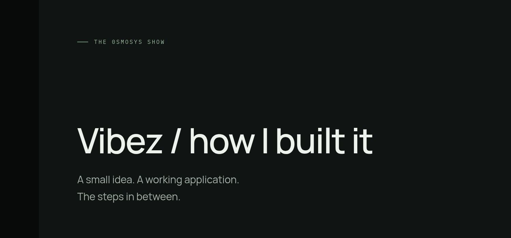

# Held Player sizing

The reported fullscreen view kept a strip of the old maximized window below the scene until advancing to another slide and returning. The supplied image contained a 1920x1008 scene region in a 1920x1080 frame.

## Diagnosis and change

Remotion's responsive Player measures its container through ResizeObserver. An already-held Player can retain its old measurement when resize notifications are missed; mounting another slide measures the new container. A controlled reproduction with resize notifications withheld left the previous Player about 228 px narrower than the new fullscreen stage.

Keep the Player and composition at 1920x1080, and fit that virtual canvas using a native CSS transform in a size container. The display scale now changes independently of Remotion's asynchronous measurements. The Player stays mounted, preserving its frame and playback state. The same wrapper serves editor preview and presentation.

The exact native event ordering behind the user's screenshot was not independently identified. The regression test deliberately withholds resize notifications to reproduce the persistent stale-size condition and verify that display fitting no longer depends on them.

## Established patterns

- [Remotion sizing](https://www.remotion.dev/docs/player/scaling) documents a Player with fixed composition dimensions and explicit CSS dimensions. The installed Player's measurement implementation was inspected; no dependency source was copied or changed.
- [CSS typed arithmetic](https://developer.mozilla.org/en-US/docs/Web/CSS/Guides/Values_and_units/Using_typed_arithmetic) supplies a unitless scale from container width divided by composition width. Support was checked in the installed Electron runtime.

## Verified

- The regression was run and failed before the implementation, with a persistent stage/content difference of about 228 px. Its failing test and the implementation are separate commits.
- The Electron regression enters presentation from a maximized window, holds the initial frame, withholds ResizeObserver notifications, enters fullscreen and verifies scene/stage bounds agree within one CSS pixel without slide navigation. It also checks unchanged slide/reveal position and a fully visible held heading.
- `yarn verify`: formatting, lint, strict TypeScript, 8 domain tests and production build passed.
- `yarn test:electron`: all 6 desktop journeys passed.
- Manually inspected editor preview, maximized presentation/fullscreen and resizing a restored presentation window. The fixed fullscreen stage and scene both measured 1920x1080. A resized window measured approximately 1144.88x643.99 for both stage and scene, with the heading still fully held at opacity 1.
- Manual fitting was also checked with resize notifications withheld. No slide change or Player remount was needed.

