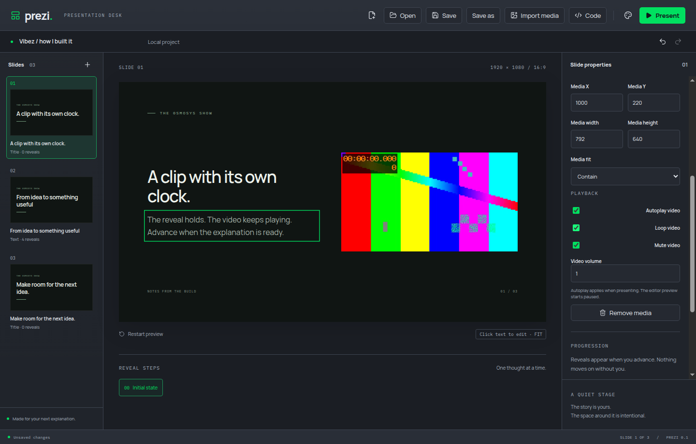
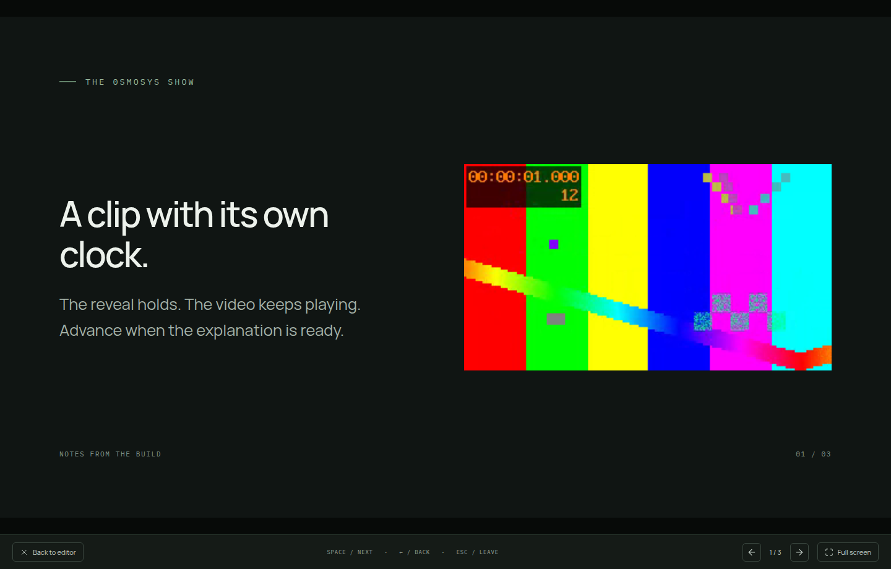

# Held video playback

Native browser video owns its playback clock independently of Remotion frames. The same video element survives reveal changes in the editor and presenter. Explicit Restart preview remounts the preview; returning to a slide starts its media again predictably. Outgoing keyed scene layers retain their last image during crossfade but pause and mute immediately, then release their media on unmount. Only active and outgoing scenes are mounted.

Media has validated placement, dimensions, contain/cover, autoplay, loop, mute and volume properties. Property patches preserve asset identity and compose atomically through the shared owner. Number fields commit on blur/Enter; checkbox drafts remain responsive while IPC completes. Autoplay applies during presentation; editor preview starts paused. Rejected browser play attempts expose a Play action rather than losing the slide. Video completion never navigates.

## Established patterns

- [Remotion Player methods](https://www.remotion.dev/docs/player/player) supply pause, seekTo and play without remounting the composition. Reveal seeks run before paint.
- [HTMLMediaElement.play](https://developer.mozilla.org/en-US/docs/Web/API/HTMLMediaElement/play) supplies an independent clock and a rejected promise for blocked or unsupported playback. Expected failures use typed Results.
- Native React pointer/keyboard controls and the existing fixed-canvas container scaling keep controls usable at different preview sizes. Media controls retain Space/arrows for playback, with Escape available to leave presentation.
- Vite raw globs collect scene dependencies and shared schemas automatically for Code view and portable archives. No dependency source was copied.

## Verified

- The video journey ran red at currentTime=0 before implementation. The configuration, editor-preview continuity and archive-source dependency tests also failed before their separate implementations.
- Tested autoplay while a reveal holds, retaining the same video node through reveals, end-of-video holding position, restart, pausing/muting inactive media and restarting on return.
- Tested autoplay off, looping/mute/volume configuration, cover fit, placement, keyboard focus on media controls and Escape. Backend tests check atomic property composition, Undo/Redo and rejection of off-stage frames.
- `yarn verify` passed formatting, lint, strict TypeScript, 14 domain tests and build. All 12 Electron journeys passed on isolated virtual displays.
- Manually inspected the generated clip and settings in the editor and its held presentation. A sample at 1.02 s had decoded 17 frames while the Remotion entrance had already completed. Audio output was disabled; this was not a listening check.
- One playing sample reported 188 MiB main, 160 MiB GPU, 173 MiB renderer and 151 MiB utility working sets, approximately 672 MiB summed, including shared pages. Test instances were closed. This is a sample rather than a system memory-pressure diagnosis.

