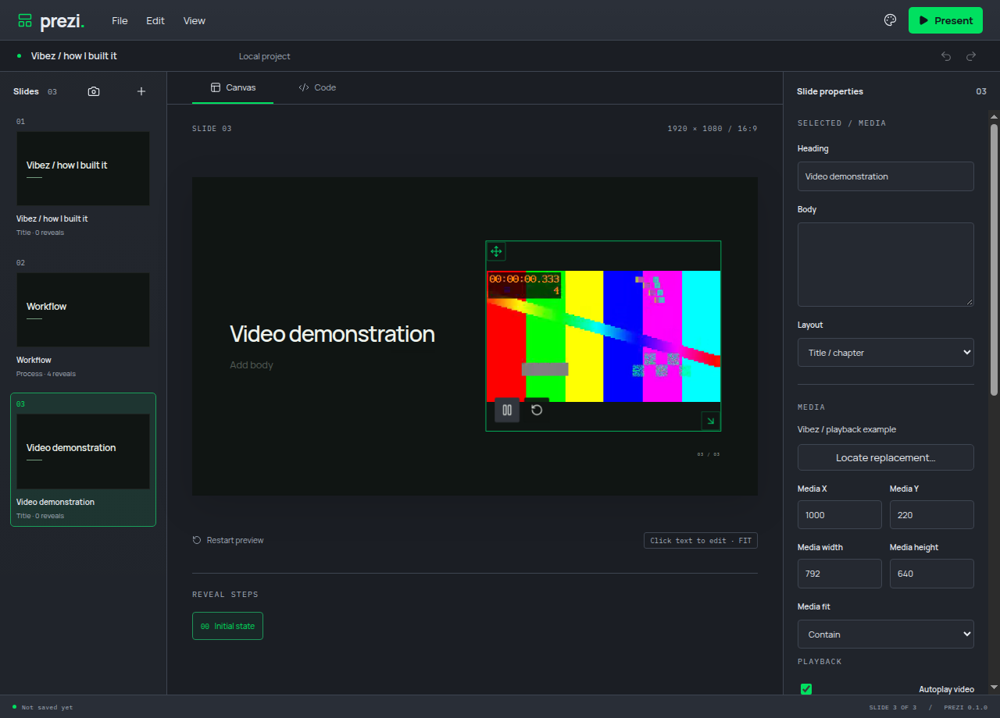

# Interrupted video playback

Review finding: #8. Cancelling a pending play request was reported as a codec/playback failure.

The shared video helper now treats AbortError as expected interruption. Other playback failures still return IO_ERROR. The browser pause/play events continue to control the visible playback state. Chromium documents that pause or a new load can interrupt the asynchronous play request: https://developer.chrome.com/blog/play-request-was-interrupted .

The component-boundary regression and real Electron pending-play regression both failed before implementation. The native test resets the valid local source with a fresh query, calls the real native play/pause methods and verifies that the rejected promise is AbortError before checking the absence of a codec error. Both unit cases and three native interruption/held-video/control journeys pass. Targeted lint, strict types and production build pass.

A separate manual private-display run reproduced the native interruption, verified no false codec error, restored normal native playback and observed its clock advance. It used muted audio, a private profile and a 2 GiB/zero-swap scope.

