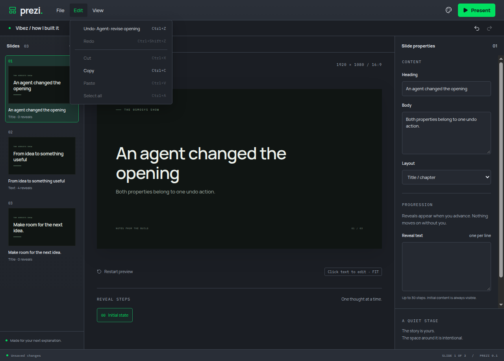

# Labelled undo and redo

Content history retains the label of each accepted batch. Edit menu items and toolbar tooltips identify the next undo/redo action. A batch containing several agent changes remains one undo action, sharing the same history as human edits. History is limited to 50 batches in memory and resets on project replacement; presentation position is excluded.

Undo and redo accept an optional request ID at the owner boundary. Repeating the same request returns its original response without changing history again. Reusing the ID for a different direction or payload is rejected. The existing bounded request cache and revision guards also apply to history requests. This extends the revisioned owner pattern recorded in ADR 0001; it does not introduce a separate agent project copy.

## Verified

- A meaningful domain test failed before labels/retry handling existed, then passed after the implementation. It exercises a human edit followed by an agent batch, undo retry, redo retry, request reuse and stale revisions.
- An Electron test failed before the Edit menu displayed its action label, then passed after the UI implementation.
- `yarn verify` and all 14 Electron journeys passed. There are 15 domain tests.
- In a private Electron/Xvfb session, changed the heading and body together through the public project bridge, selected the labelled Undo menu item, observed both original properties, then used Redo and observed the agent changes again. Captured the rendered menu after the entrance animation settled. No user desktop or media was accessed.
- MCP transport verification follows in its own delivery. This change proves shared owner/renderer recovery, not an MCP client connection.

