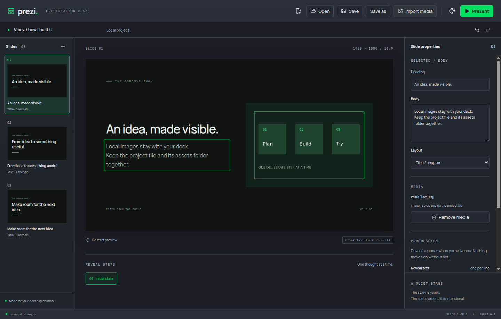
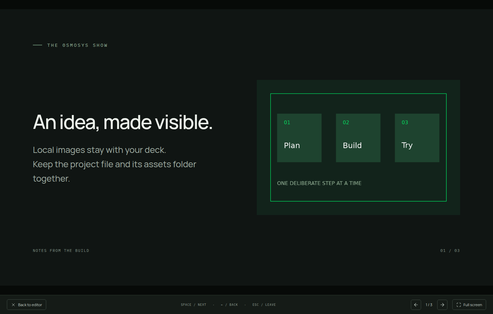

# Local media import

Import media attaches a disk-backed asset to the selected slide. Metadata contains a stable UUID, name, kind and supported extension. Bytes never enter project snapshots or undo history. Duplicate slides share the same asset; removing media is undoable.

Imports copy into the app session's temporary asset store so deleting or moving the source does not break the open deck. JSON saves copy referenced assets beside the project into `<project path>.assets`, using UUID filenames. Save As copies those assets to the new location before atomically replacing its JSON file. Keep the file and this directory together. A single-file `.prezi` container is a follow-up requirement and will replace this default save format.

Only assets referenced by the open project can be requested through `prezi-media://asset/<uuid>`. The privileged Electron protocol forwards a bounded file stream through Chromium and supplies range response headers. Missing media produces a visible error in the scene, and failed imports or saves preserve the current project. Importing another file replaces a missing asset.

Video metadata and a native video element are included as the import foundation. Playback controls, continued playback through reveals, placement and playback settings are the next focused slice.

## Patterns and licences

- [Electron protocol](https://www.electronjs.org/docs/latest/api/protocol) and [net.fetch](https://www.electronjs.org/docs/latest/api/net) provide the registered scheme and native streaming file handler. No dependency code was copied.
- Forgecut's media-protocol.ts informed single byte-range response handling. Its root has no licence; no source was copied. Byte-range parsing was implemented locally with explicit typed results and safe integer checks.
- [MDN range requests](https://developer.mozilla.org/en-US/docs/Web/HTTP/Guides/Range_requests) informs 206, Content-Range, Accept-Ranges and 416 handling. Malformed and multi-range headers are ignored and served as full responses.

## Verified

- Ran and committed a failing owner import test before implementation; it now checks import, deleting the original file, disk bytes after save, undo/redo, reopen and Save As.
- Ran and committed a failing Electron test before implementation; it checks decoded image dimensions, an eight-byte ranged request, reference removal preventing further reads, undo/redo and presentation.
- Removal and safe integer range tests each failed before their separate fixes. Failed, missing and stale imports preserve the original project and revision.
- Formatting, strict TypeScript, lint and 11 domain tests passed. All 8 desktop journeys passed on an isolated Xvfb display. No user desktop was used for this slice.
- Manually imported a generated 960x640 workflow image on a private virtual display, edited its heading/body, saved, created a blank deck, reopened the saved project and inspected the image in presentation. The example image was generated locally with FFmpeg; no user media was copied.

