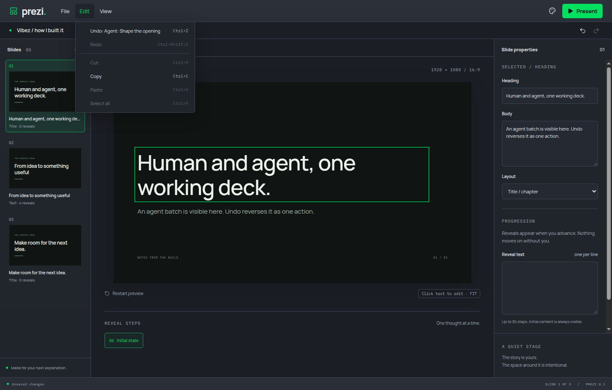
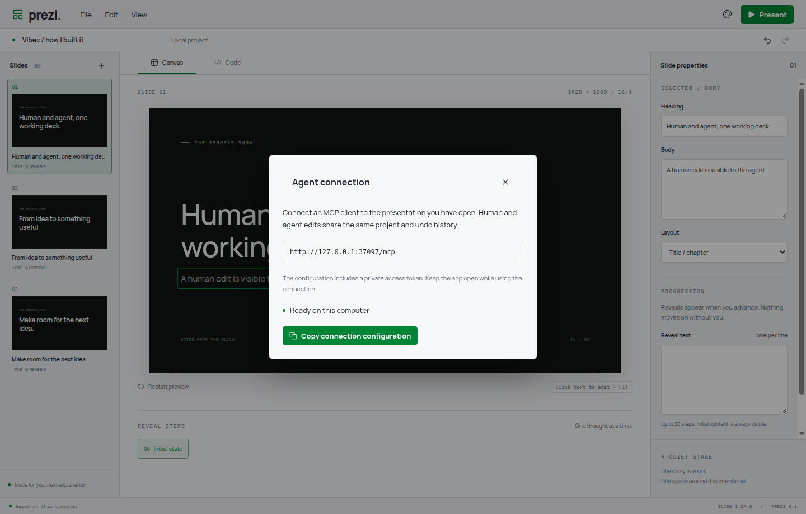

# Shared MCP workflow

The official MCP v2 server and Node Streamable HTTP transport are thin adapters over the existing ProjectOwner. They do not maintain a second deck. WorkspaceOwner holds only ephemeral selection and presenter position. UI content changes and MCP content changes use the same revision, batch, history and broadcast path. Outgoing presentation state is never part of content history.

## Established patterns

- The [official SDK Node adapter](https://github.com/modelcontextprotocol/typescript-sdk/tree/main/packages/middleware/node) informs stateless transports, loopback binding and Host/Origin guards. Each request gets a protocol server/transport referencing the same owner, released after its response closes.
- Auto Digger's local authenticated connection and tool adapter informed the private discovery file and clipboard configuration. Forgecut's revisioned owner pattern was already recorded in ADR 0001. These are design references; no source was copied.
- Installed SDK packages are server/client 2.4.0 and Node adapter 2.1.2. The upstream licence is retained in licenses/mcp-sdk.txt.

## Verified

- A real SDK client/Electron journey failed before the endpoint existed, then passed after implementation. Separate red tests preceded selection/position, bounded reads, media registration, connection UI, request reservation and concurrent save protection.
- Verified UI edits through MCP and agent edits in the UI; shared labels/undo/redo; uncertain request retries; stale revision rejection; whole-batch rejection; selected body/heading IDs; presenter position; bounded source chunks and arbitrary-path rejection.
- Imported the generated video through MCP twice with the same request ID and observed one revision. Its native video node remained connected and playing while an unrelated slide changed. Slide/reveal position remained held.
- Tested missing-token rejection and non-local Origin rejection. Connection-copy verification reads only the isolated display's clipboard and compares credentials without printing them.
- Domain verification covers concurrent import retries, cross-operation request-ID reservation and an actual asynchronous save receiving a newer edit. The newer edit stays dirty and prevents save-before-close approval.
- `yarn verify` passed formatting, lint, strict TypeScript, 18 domain tests and build. All 15 Electron journeys passed on isolated Xvfb displays.
- Manually connected the official SDK client to an isolated Electron instance; edited a two-property batch, observed it on canvas/inspector, undid/redid it through the menu/buttons, typed a human body change and read it and selection through MCP, then saved a portable project. Inspected the shared edit in dark mode and connection dialog in light mode. Tokens are absent from screenshots.
- One editor/MCP sample reported Browser 204 MiB, GPU 155, renderer 160 and utility processes 152, approximately 671 MiB summed working sets. Shared pages may be counted more than once. This is a sample, not a memory-pressure diagnosis. All own instances were closed; no user desktop interaction or microphone capture occurred.

