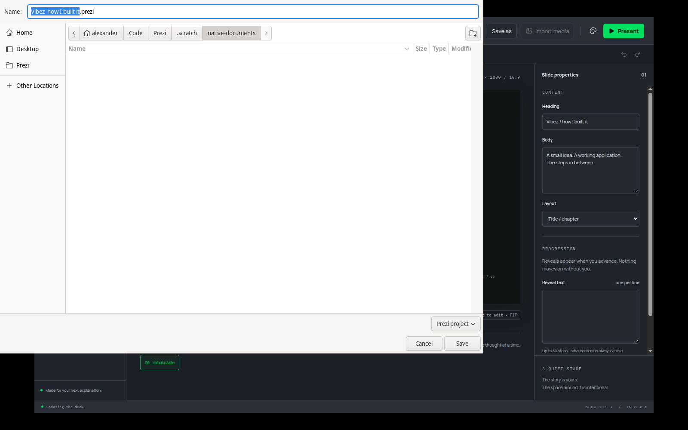

# Portable project verification

- Ran a failing test showing `.prezi` output was still plain JSON, committed it, then implemented a streamed ZIP container.
- The test imports an image, saves a project, checks archive entries and source content, moves only the `.prezi` file, deletes the original media and import cache, then reopens it and verifies the restored bytes. Save As creates another independent archive.
- Font style and runtime dependency checks ran red before their separate implementation commits.
- A failed save with missing media leaves the previously saved archive byte-for-byte unchanged. Opening corrupt input leaves the current project and revision unchanged.
- An Electron test ran red on the former JSON default path/filter. The default now uses `.prezi`; the test saves actual archive bytes through the desktop command and reopens its edited heading.
- `yarn verify` passed formatting, lint, strict TypeScript, 13 domain tests and production build. All 9 Electron journeys passed using an isolated virtual display.
- Inspected the actual native save dialog on a private Xvfb display with isolated GTK configuration and a private empty documents directory. The filename ends in `.prezi` and the Prezi project filter is selected. The native dialog's final save was not confirmed manually; archive saving/reopening was exercised through the desktop command with a controlled dialog destination.

