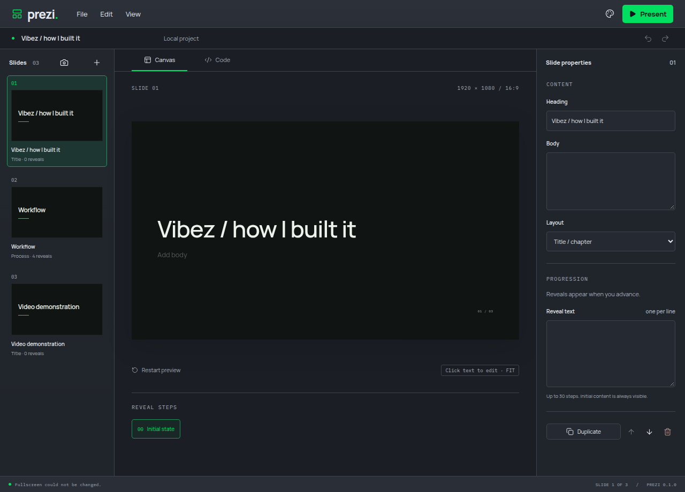

# Presenter exit recovery

Review finding: #1. Escape and Back to editor previously stayed in the presenter when fullscreen returned an error.

Both paths now leave the presenter regardless of the fullscreen result. The editor retains and displays the fullscreen failure; an unexpected bridge rejection also returns to the editor. The existing application command routing already treats fullscreen changes as a recoverable desktop operation, which informs this change.

Both real Electron regressions failed against the previous implementation after startup completed and the fullscreen handler was replaced with a typed failure. The corrected implementation passes both, plus the normal fullscreen/reveal presentation journey. Targeted lint, strict types and production build pass.

A separate manual run exercised Escape and Back to editor with the same failure, verified the editable Canvas returned and inspected the error in the editor. Verification used a private display/profile, muted audio and a 2 GiB/zero-swap ceiling.

