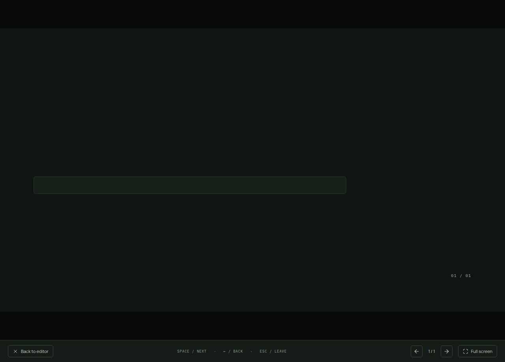
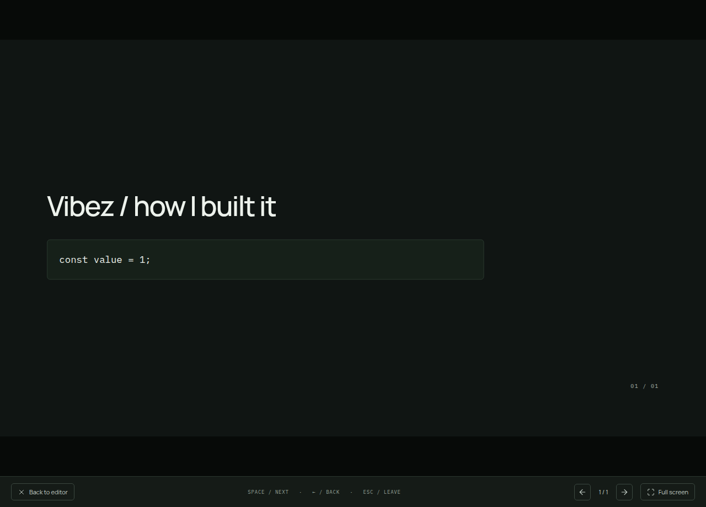

# Project-owned layout text

Reusable layouts render project text. New slides and new presentations start with empty heading/body/code content. Untitled labels in editor controls identify empty items without writing those labels into slide content. The code layout no longer injects SOURCE / WALKTHROUGH or sample-code text. The explicitly requested Vibez example deck is separate from these defaults.

A real Electron regression first failed because a new presentation contained a generated heading. After implementation, six desktop/menu/file/interface-copy journeys pass, along with targeted lint, strict types and the production build.

A separate manual run created a new presentation, selected Code explanation, checked empty fields and presented the empty layout. It then entered a heading and code and verified that the presenter rendered them without adding a label. Screenshots show both states. Verification used a private display/profile with muted audio and a 2 GiB/zero-swap ceiling.

