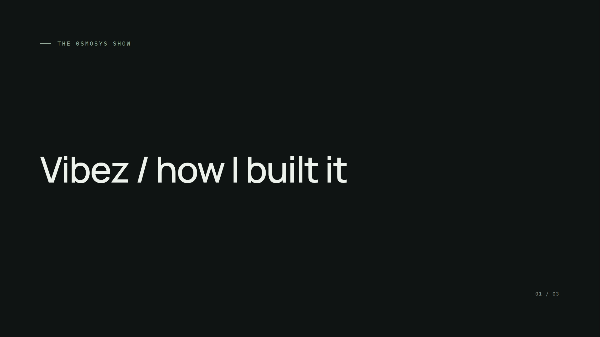
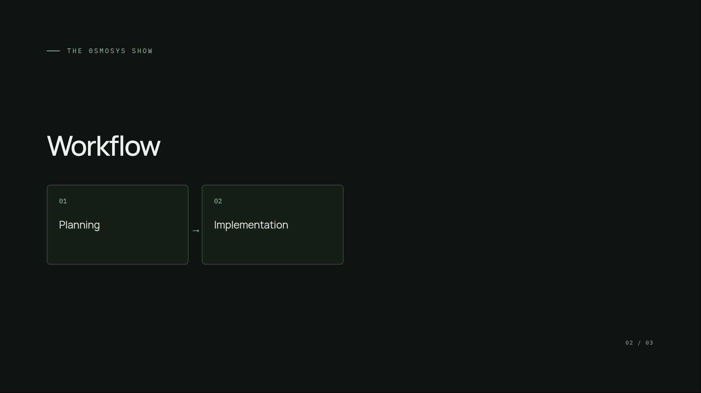
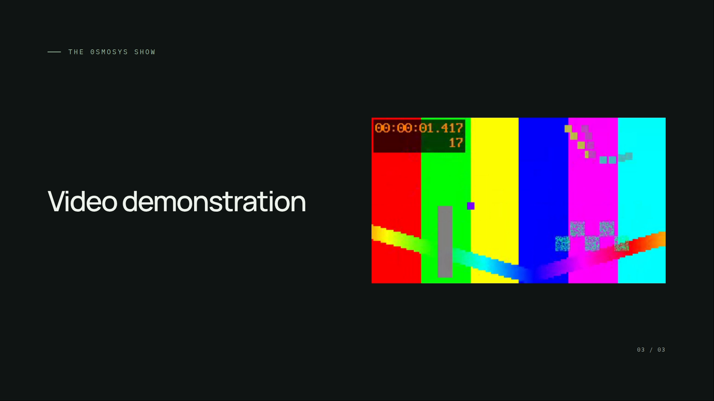
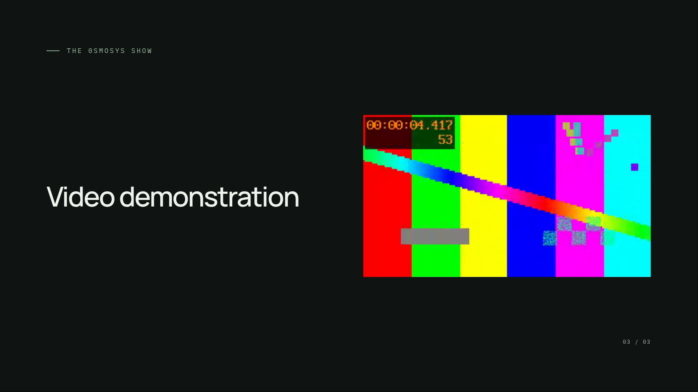

# Final recording rehearsal

Recorded the installed Linux application using OBS 30.0.2. The encoded H.264 recording is 1920 by 1080 at 30 fps, lasts 25.834 seconds and contains 16,158,931 bytes. Its checksum, raw OBS counters and kernel budget readings are retained in [recording-metrics.json](recording-metrics.json).

The workflow entered Present and fullscreen on the first slide, advanced manually through workflow reveals, held the video slide, returned to the preceding slide, then resumed video on return. The first held video reached 4.758 seconds. The final slide stayed visible. OBS reported zero output-skipped and zero render-skipped frames, with an average frame-render time of 10.37 ms.

Inspected decoded frames at 1, 10, 16, 19 and 23 seconds. The initial title and footer fit before any slide navigation. Workflow content and the video remained within the stage; editor controls were absent. The video timer advanced from 1.417 to 4.417 seconds on the held slide and restarted after returning. This verifies encoded output as well as the live interface.

OBS and Prezi ran on private Xvfb screens in a separate network/mount namespace. The OBS controller used screen 1 and captured only the private presentation on screen 0. Physical devices were hidden. Pulse/PipeWire connections were disabled, only the needed video/output plugins were loaded, and the authenticated OBS API confirmed all six desktop/microphone inputs were null before recording. No user desktop, microphone or camera was captured. The audio check verified input configuration through the API.

Ubuntu OBS packages were extracted privately without a host installation. Their compiled helper/data locations were mapped inside the private filesystem namespace. All verification applications were closed afterward. The local MKV and MP4 artifacts remain in `.scratch/prezi-recording-rehearsal.*` and are excluded from Git.

## Resource observations

| Journey                                 | Kernel charged peak | Memory ceiling | CPU ceiling | Swap ceiling |
| --------------------------------------- | ------------------: | -------------: | ----------: | -----------: |
| Linux 0.1.0 AppImage packaging          |          1584.5 MiB |          2 GiB |      1 core |            0 |
| Installed editor/custom scene checks    |           823.6 MiB |          2 GiB |     2 cores |            0 |
| Latest 0.1.1 candidate packaging        |          1426.7 MiB |          2 GiB |      1 core |            0 |
| Download/restart/update handoff         |          1035.1 MiB |          2 GiB |     2 cores |            0 |
| Xvfb, installed Prezi and OBS rehearsal |           741.5 MiB |          2 GiB |     3 cores |            0 |

These are cgroup charged peaks with warmed filesystem caches, not summed process RSS or universal memory guarantees. These installed and update measurements follow the final viewer-readiness fix; the recorded built-in slides use the same presentation path as the rehearsal. The installed custom-scene checks additionally use separately bounded compiler/scene scopes. Every measured parent scope reported zero OOM events. Linux compiler and renderer limits are covered by their separate verification notes; macOS/Windows do not have the Linux cgroup boundary.

