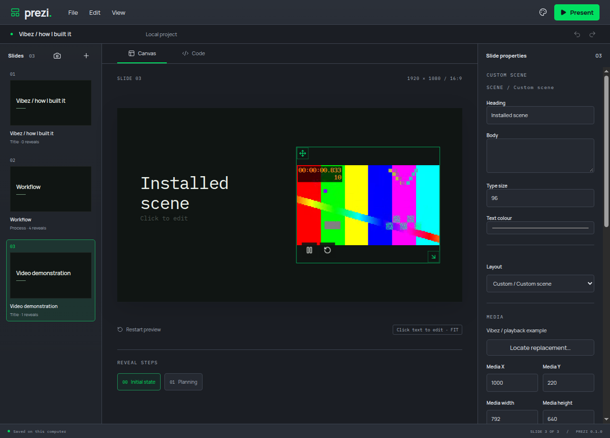
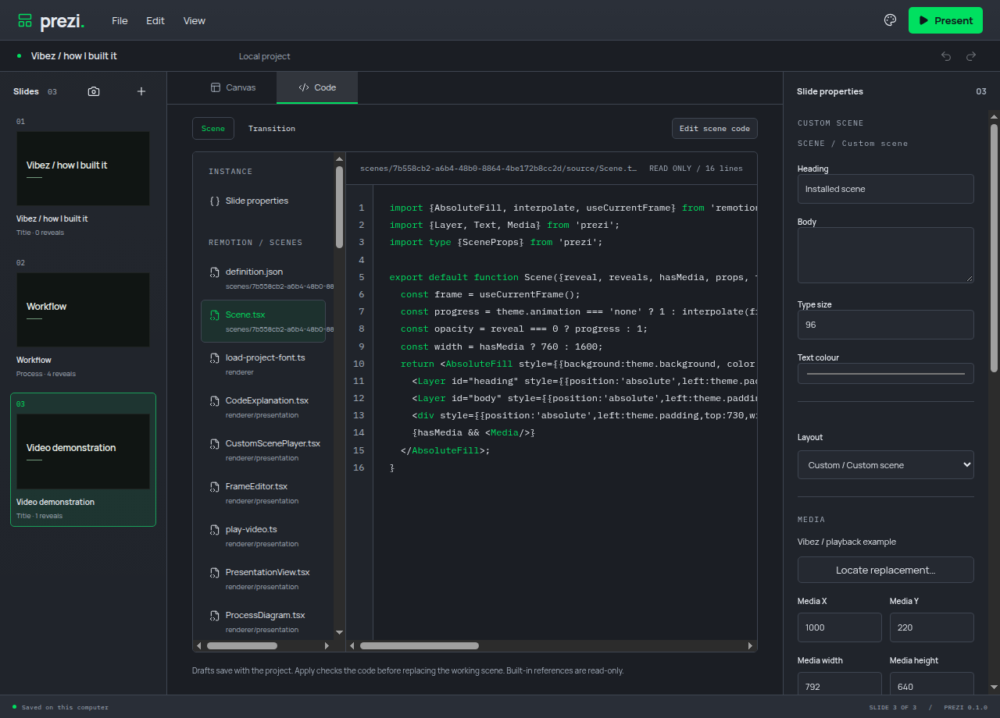
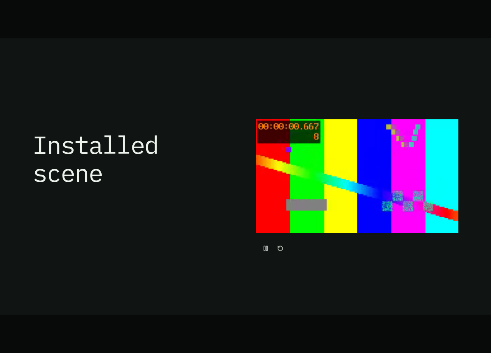
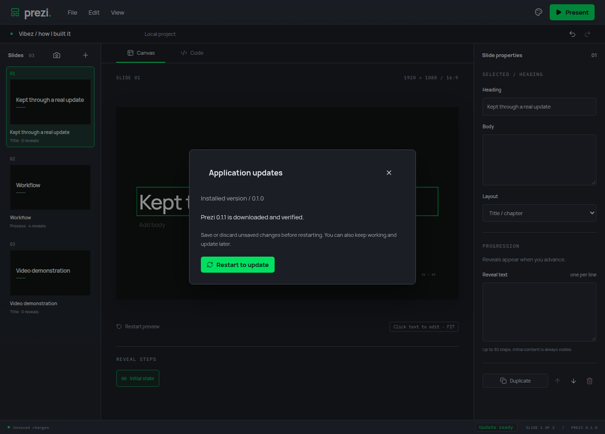
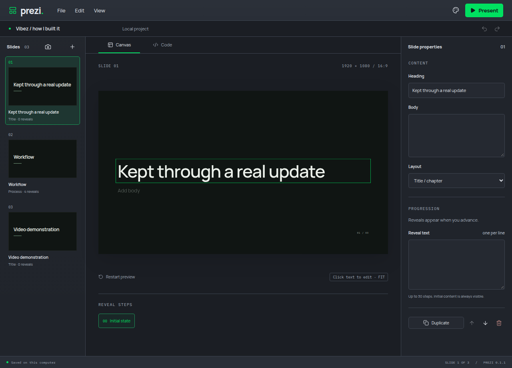

# Review fix verification

All 22 marked findings are mapped in the [review fix ledger](review-fix-ledger.md). All fixes remain in focused feature PRs targeting dev. No branch promotion or release publication has occurred.

## Combined checks

Formatting, lint, strict types, 99 unit tests and the production build pass. All 54 real Electron journeys pass in 229.6 seconds on a private display. This includes source drafts, shared Undo, MCP collaboration, media controls, menus, portable saves, viewport recovery, startup/stall recovery and the new review regressions. The slow 30-reveal validation case completes in 40.8 seconds.

The latest Linux package passes both installed journeys, including custom compilation, imported fonts, retained source catalog, portable reopening, held video and MCP. The private 0.1.1 candidate passes actual download/checksum validation, AppImage replacement, restart and recovery of saved content. Only GitHub release discovery is fixture data; the package download and lifecycle are real.

The latest application changes pass Linux x64, Windows x64, macOS arm64 and macOS x64 installer CI and complete release-set assembly: [application checks](https://github.com/alexanderwanyoike/prezi/pull/55/checks). Updated source-catalog installer verification also passes on all four platforms in [#54](https://github.com/alexanderwanyoike/prezi/pull/54/checks). The final handoff PR contains documentation and screenshots.

All 28 embedded images in the individual fix PRs were checked and returned HTTP 200. Their descriptions retain focused comparisons and dependencies.

## Installed manual workflow

A separate private-display manual run used the rebuilt installed application. It imported a font and notice, compiled a custom scene, edited canvas text, played video while reveals held, saved a portable project, created a fresh deck and reopened the saved project. It checked the retained source catalog, opened Code, entered native fullscreen, advanced from the first slide to the custom video slide, verified visible content and playing video, then returned with Escape. Screenshots show the reopened canvas, accepted source and fullscreen presenter. The update images show the verified download and recovered deck after restart.

## Resource observations

All verification used private displays/profiles and disabled physical audio. Outer process scopes were capped at 2 GiB with zero swap; builds used one CPU and app verification used two. Compiler and isolated scene processes retain their own enforced budgets. The figures below are warmed-cache charged scope peaks, not universal memory guarantees.

| Scope     | Peak MiB | OOM events |
| --------- | -------: | ---------: |
| verify    |   1138.6 |          0 |
| electron  |    773.8 |          0 |
| package   |   1570.7 |          0 |
| candidate |   1662.5 |          0 |
| installed |    806.6 |          0 |
| update    |   1036.5 |          0 |
| manual    |    366.0 |          0 |

Raw readings are retained in [review-fix-metrics.json](review-fix-metrics.json). Each scope reports zero OOM and OOM-kill events.

## Artifact

The rebuilt local artifact is release/Prezi-0.1.0-linux-x64.AppImage (149,882,651 bytes). SHA-256: 2a11d581e9fcca85e948bf004d08b81078ea5b5604b899164f84ec50576ef5f1. The identity is also stored in [review-appimage.json](review-appimage.json). The 0.1.1 package is a private update fixture; no release was published.
