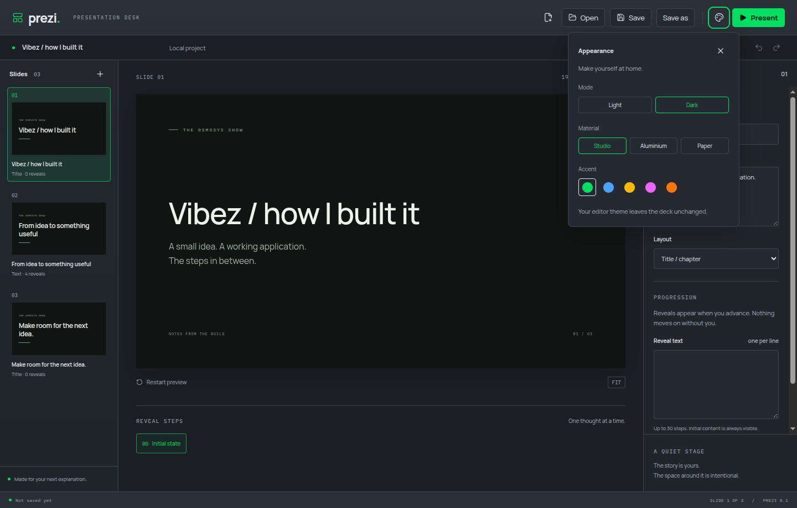
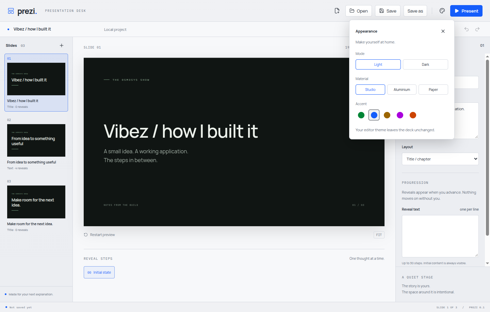

# Saturated editor accents

The editor now uses vivid solid accent colours in both light and dark modes. Material surfaces and the presentation deck theme retain their existing colours. Existing saved appearance choices still resolve through the same accent IDs.

The palette follows the role separation used by [Radix Colors](https://www.radix-ui.com/colors/docs/palette-composition/understanding-the-scale): a high-chroma solid accent and a foreground chosen for legibility. No Radix source code or palette was copied. The rendered primary button label is checked against the [WCAG 4.5:1 minimum contrast ratio](https://www.w3.org/WAI/WCAG22/Understanding/contrast-minimum.html).

## Verified

- A failing Electron test first reproduced the existing low-saturation colour: the light Sage accent measured about 21% HSL saturation.
- The maintained Electron journey selects all 30 combinations of three materials, two modes and five accents. Each painted primary accent has at least 80% HSL saturation, label contrast at least 4.5:1 and a matching painted swatch.
- Root accent selectors now outrank the light-mode fallback, so selecting a light accent actually changes the controls. Dark-mode swatches also use the corresponding dark-mode colour.
- Manually inspected the actual Electron editor with saturated green in dark mode and cobalt in light mode. Reloading preserved the selected light cobalt preference.

