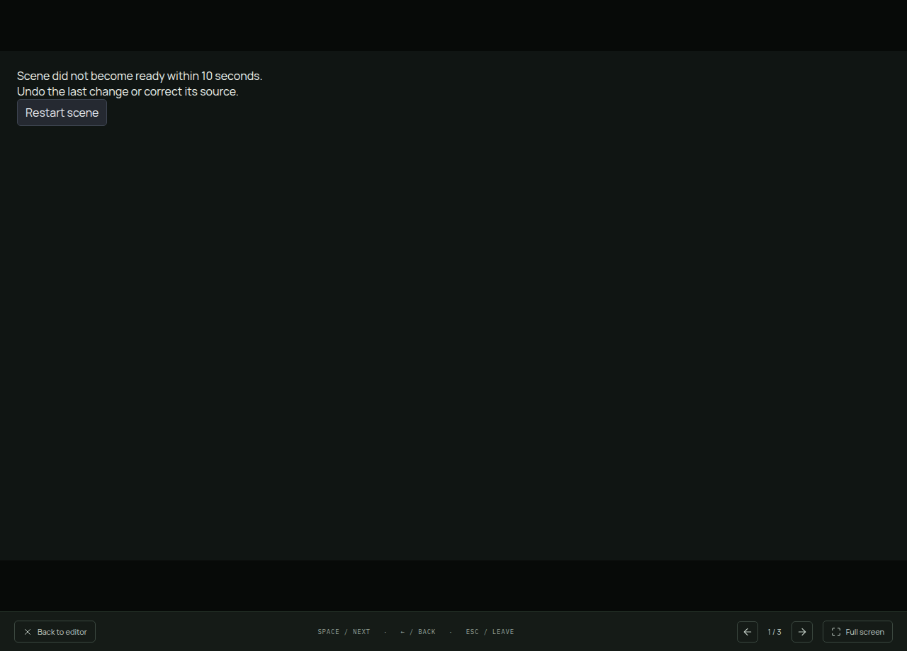
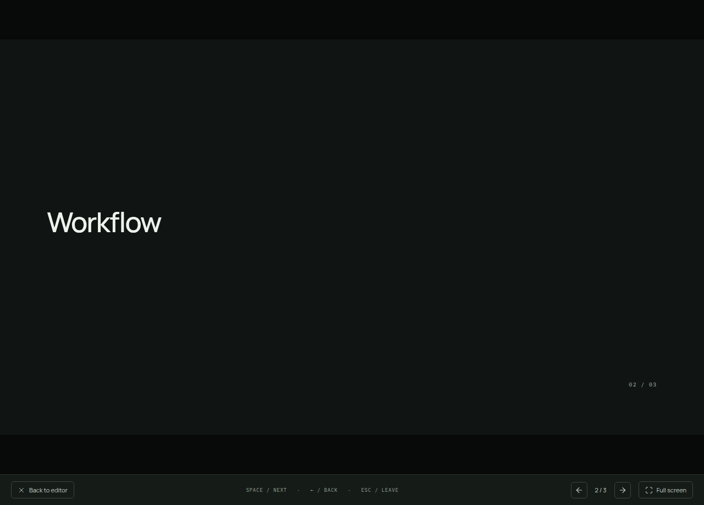

# Bounded custom-scene startup

Review findings: #29 and #34. Presentation waited indefinitely when the incoming frame never loaded or preparation never replied. Heartbeats alone also could not establish that a scene had become ready.

The watchdog now starts when the frame mounts. Startup has a ten-second visible deadline independent of heartbeat activity. After a ready status, the existing six-second heartbeat check applies. Failure detaches the frame, keeps the recovery controls and releases the presentation step through the existing ready/error callback. Hidden documents pause the visible startup interval. Restart and content recovery reset readiness for the new instance.

Three component regressions first reproduced no-load, stalled-preparation and heartbeat-only startup failures. All four startup tests pass. The real Electron lost-preparation regression also failed on the previous built app and now passes. Five native viewport, steady-state stall, startup and programmed-transition journeys pass, together with strict types, targeted lint and the production build.

A separate manual private-display run compiled a real custom scene, withheld the next preparation reply, inspected the deadline error, then advanced to the working workflow slide. The existing bounded renderer/watchdog pattern is reused; no new worker or dependency was added. The demo used muted audio, a private profile and a 2 GiB/zero-swap scope.

