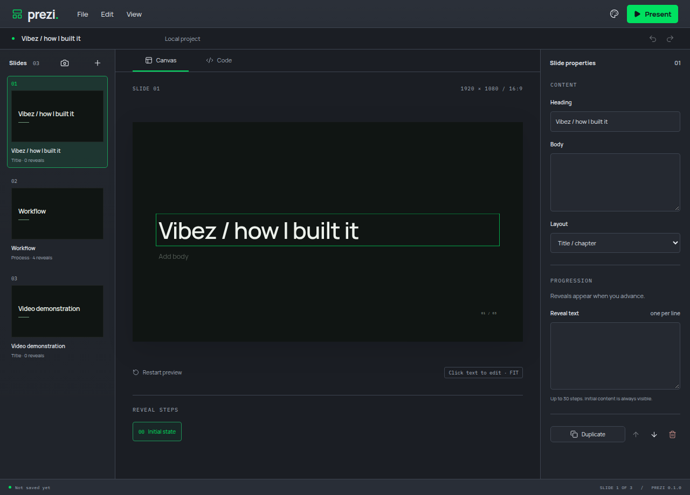
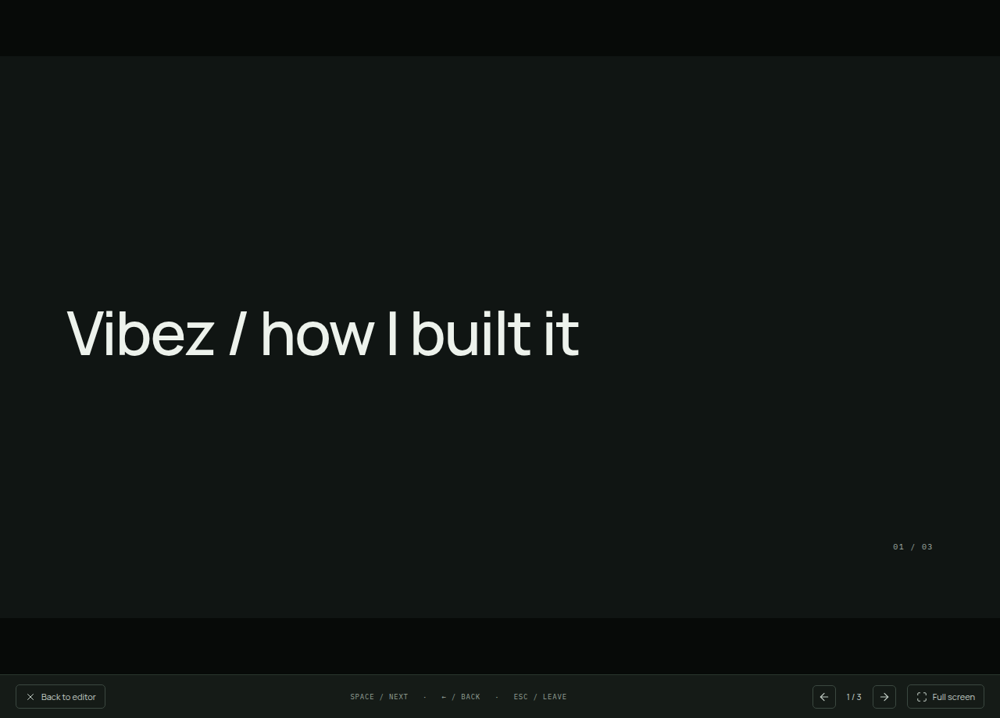
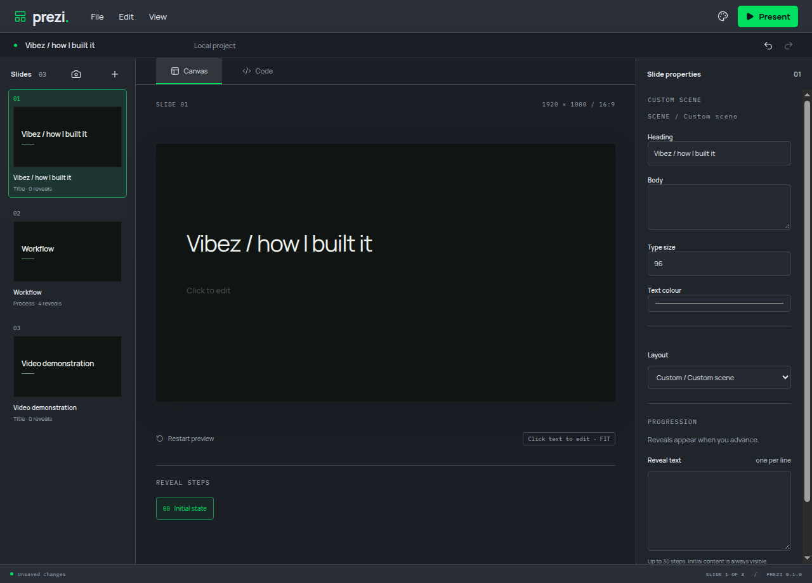

# Remove injected slide branding

Built-in slides, fallback thumbnails and generated custom-scene source no longer inject a show name. The heading remains vertically centred after removing the built-in kicker. Unused kicker CSS was removed. Project-authored text remains the content source.

A new draft regression and the real Electron interface-copy regression both failed while the branding was present, before the implementation commit. Both pass afterward. Strict types, targeted lint, the production build and both interface-copy/presenter navigation journeys pass.

A separate manual run inspected Canvas and Present, created and applied a custom scene through Code, then inspected its isolated Canvas. All three paths omitted the branding. Screenshots were captured after the entrance opacity reached its final state on a private display/profile with muted audio and a 2 GiB/zero-swap limit.

